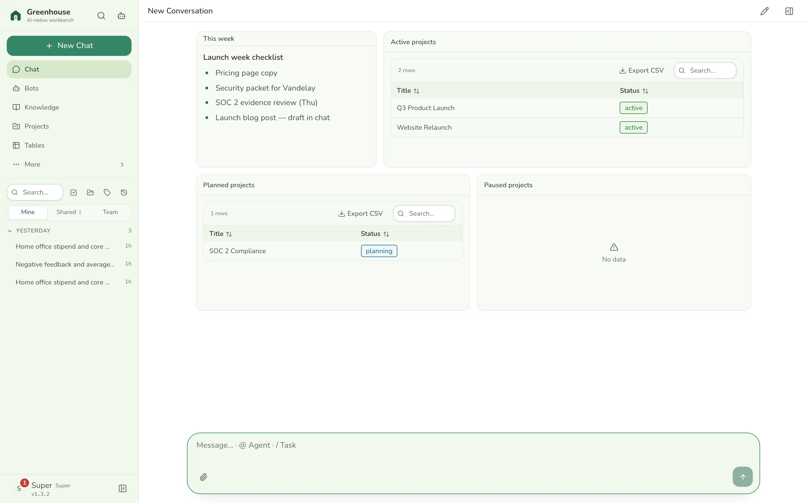
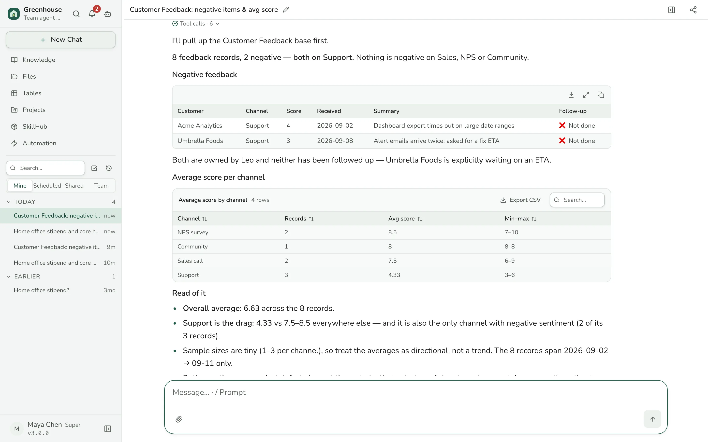
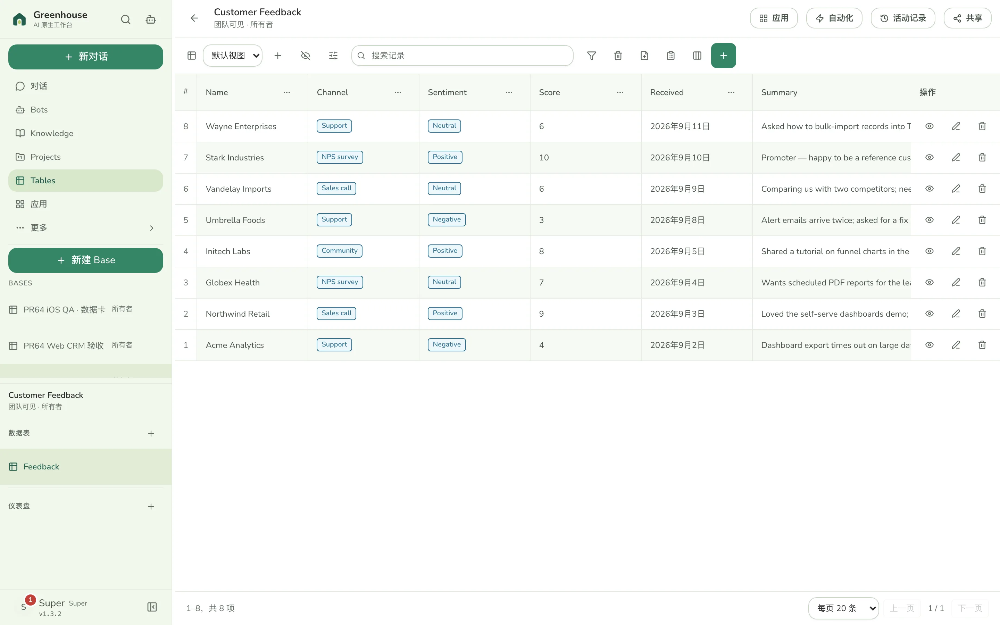
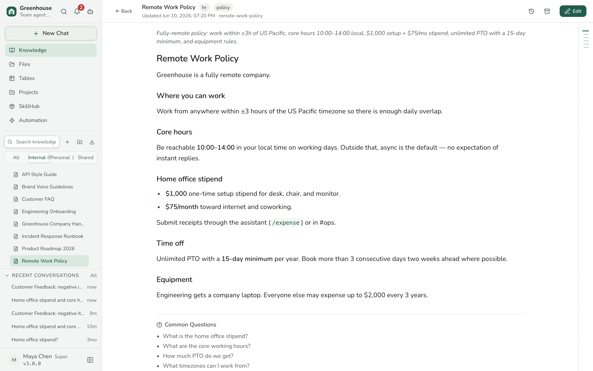
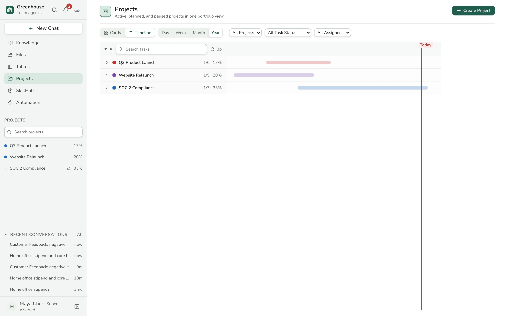
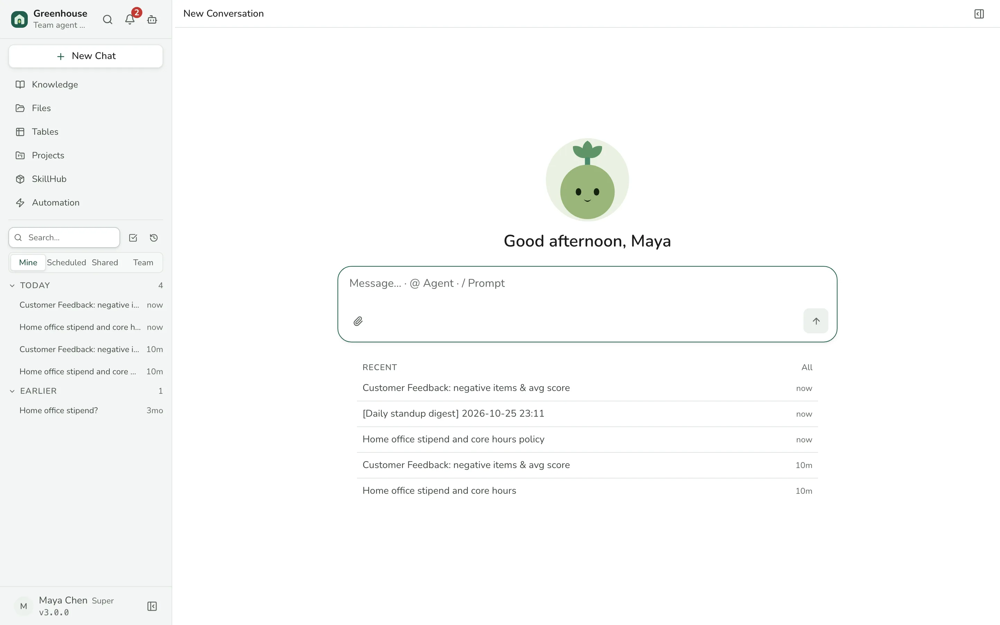
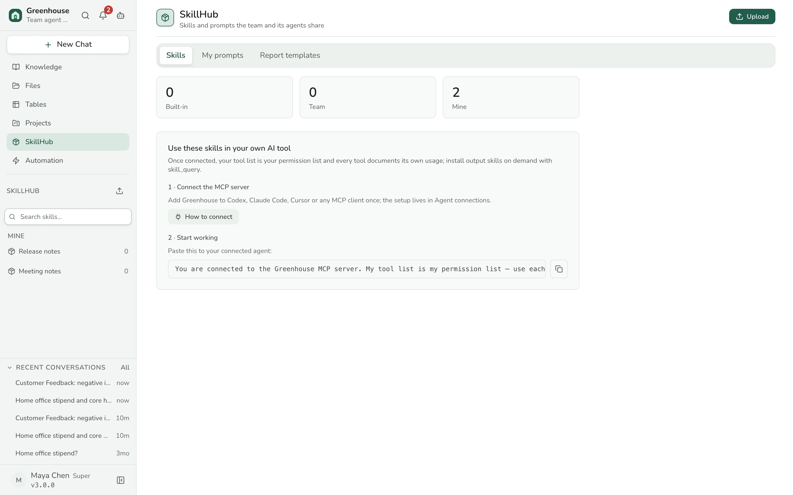
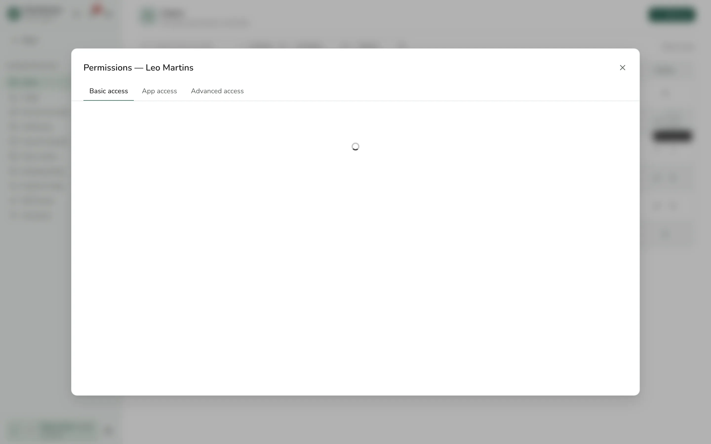
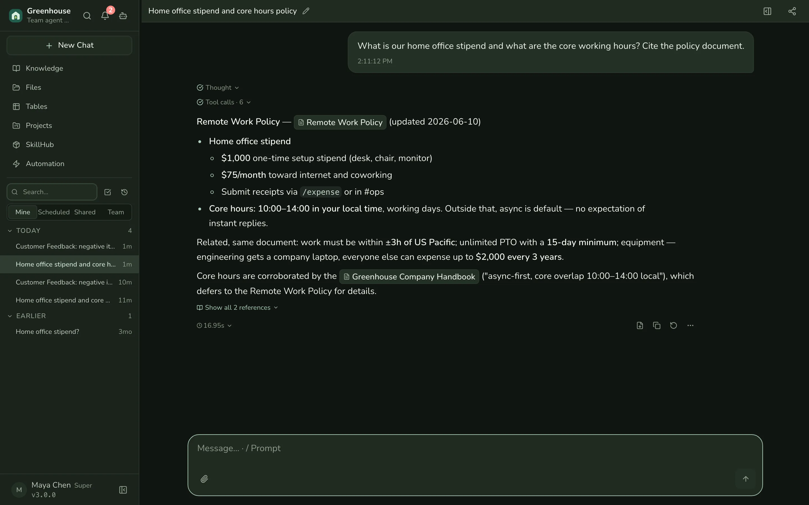
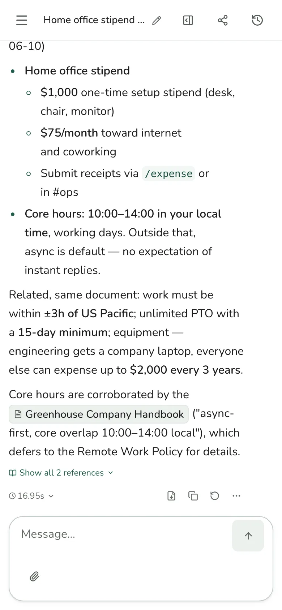

<p align="center">
  
</p>

Visual identity: [Haven logo, Nunito typography and shared design tokens](logos/README.md).

<p align="center">
  <a href="https://greenhouse.linjiejim.com"></a>
  <a href="./LICENSE"></a>
  <a href="https://github.com/linjiejim/greenhouse/releases/latest"></a>
  <a href="https://github.com/linjiejim/greenhouse/actions/workflows/ci.yml"></a>
  <a href="https://github.com/linjiejim/greenhouse/stargazers"></a>
</p>

**An open-source, AI-native enterprise agent workbench.** One command to self-host, members
log in with accounts (no app to install), and every capability is also callable by external
agents over [MCP](https://modelcontextprotocol.io/). Admins author tools in code that
auto-expose over chat, `/api/agent`, and `/api/mcp` — add a tool by writing one file.

Greenhouse is built around the idea that the agent *is* the product, not a feature bolted on
the side. Chat, the knowledge base, projects, tables, automations, missions and email all share
one tool layer and one permission model; the same tools your team uses in chat are the ones you
expose to Claude, Cursor, or any MCP client.

> 当前 `v2` 分支仍在开发。v2 表格中的记录可交给自己的 Agent 在后台处理；评论和字段结果遵守写入审批。表格内的自动化支持记录、日期、间隔和按钮触发，统一通知成员、唤醒 Agent，或向公网 HTTPS 地址发送签名 webhook。Agent 也能按成员权限查询和操作已发布应用；外部客户端需要单独授权 `apps:read` / `apps:write`。
> #70：电脑支持全屏、满额排队和存储服务中的加密主目录备份；管理员可备份及恢复。应用外部数据卡使用查看者自己的连接，自定义代码卡逐发布版本审核后在隔离画框中只读运行。

## A quick look

<p align="center">
  
</p>
<p align="center"><sub>Grounded answers: the agent searches the team knowledge base, cites the policy document, and the trace shows every tool call.</sub></p>

<table>
  <tr>
    <td width="50%" valign="top">
      
      <b>Home workbench</b> — live cards backed by the same tools; edit by drag-and-drop or ask the agent.
    </td>
    <td width="50%" valign="top">
      
      <b>Data in chat</b> — the agent queries a Tables base and answers with sortable, exportable tables.
    </td>
  </tr>
  <tr>
    <td width="50%" valign="top">
      
      <b>Tables</b> — typed fields, views, forms and record links; the agent plans schemas conversationally.
    </td>
    <td width="50%" valign="top">
      
      <b>Knowledge base</b> — team, personal and shared documents with backlinks and full-text search.
    </td>
  </tr>
  <tr>
    <td width="50%" valign="top">
      
      <b>Projects</b> — portfolio timeline, boards and task trees with members, comments and activity.
    </td>
    <td width="50%" valign="top">
      
      <b>Execution center</b> — automations, missions, workflows and sub-agents in one place, with an approval inbox.
    </td>
  </tr>
  <tr>
    <td width="50%" valign="top">
      
      <b>Skill Center</b> — versioned SKILL.md bundles with changelogs and security scanning.
    </td>
    <td width="50%" valign="top">
      
      <b>One permissions dialog</b> — roles, capabilities and feature flags, enforced once for HTTP, chat, the proxy and MCP.
    </td>
  </tr>
</table>

<p align="center">
  
  
</p>
<p align="center"><sub>Light / dark / system themes and a responsive layout. The <a href="apps/mobile">native API v2 app</a> opens your main thread with Greeny, conversations, Agents, runs, needs-you cards, notifications and the live computer. iOS uses system navigation, SwiftUI forms and Liquid Glass controls; Android uses Material 3 forms, menus and dialogs.</sub></p>

The native v2 app opens knowledge spaces and folders, reads and edits Markdown, and shows versions, comments, sharing, signed file previews and search. Tables use phone record lists (with a grid switch), kanban, agendas and read-only timelines; records and internal forms use native sheets. Agent mailboxes show allowed senders and held mail, with mail cards in conversations. Configured transcription fills the composer without sending; read-aloud uses the speech service or device voice.

The mobile launch cover leaves as soon as authentication, fonts and the focused page are ready;
the 650 ms logo animation adds no minimum wait. Unsettled content gets up to 900 ms before
the page’s loading or retry state is shown. Wide mobile tables offer a vertical record view
as well as a grid of the view's first six visible fields; each record opens all readable fields. On iOS, chat and computer files open in native Quick Look
(PDF, images and system-supported document formats); sharing/saving remains available.

Every image above is produced by `node scripts/capture-screens.mjs` against a seeded dev stack — the
same script doubles as an end-to-end smoke tour (see [Development](#development)).

## Features

- **Conversations** — one list for every place you talk: your **main thread** with your main
  Agent (the app opens on it), your other Agents' threads, **conversations with other people**
  (a private chat with one colleague, or a room with several — each brings their own Agents, and
  Agents consider unaddressed messages and contribute only when useful; @ a person or Agent to direct a message only to them), the
  background tasks your Agents run, and your **chats** — separate conversations with a fresh
  context for anything separate. The sidebar groups the larger main Agent with other **Agents**, then
  **People**, then **Chats**; each heading owns its relevant actions. The Agents `+` opens a blank
  Custom form directly. Desktop message times and short read receipts share one floating hover row.
  Expo also offers room members in @ suggestions and reports actually visible message ends as read. Chats stream
  with tool-call traces, attachments of any file type (the agent reads text / CSV / JSON / xlsx /
  docx / PDF), per-turn model switching from a config catalog, a side pane for artifacts and
  records, session forking, background runs, sharing / grouping / tagging, and a global ⌘P search.
  Voice input fills the composer (your speech-to-text service, else the browser's own
  recognition) and replies can be read aloud (text-to-speech, else the browser's voice); audio
  attachments are transcribed for the agent.
- **Knowledge Base** — team, personal and shared docs and files in one folder tree, a Tiptap editor
  (`/` blocks, `[[` doc links, @-mentions, pasted pictures, tables) over Markdown-first storage,
  who-is-viewing and who-is-editing, saves that never overwrite someone else's, version history
  with line and word diffs, backlinks, comments, templates, sharing with members, groups or
  everyone, Markdown and ZIP export, and segmented full-text search (CJK-aware).
- **Projects** — projects, tasks (board / gantt / tree views), members, comments, activity log.
- **Tables** — bases of data tables with typed fields (text to attachments, record links, parent
  records and dependencies); grid, board, calendar, gallery and timeline views (a gantt with
  dependency arrows and milestones, dragged to change dates), each with its filters, sorts and
  groups, shared or personal; editing in cells or a record drawer, pasting blocks, comments and
  history, a recycle bin, forms, CSV import/export, shared or personal dashboards, and a Projects
  template. Formula, lookup, rollup and AI fields have editors and read-only results; AI values can
  be regenerated. Owners share with four built-in roles or custom table, row and column rules.
  Readers can create personal dashboards from the table tabs. Automations and Agent tools follow.
- **Home workbench** — a personal dashboard of live cards backed by the same tools (recipes and
  templates), editable by drag-and-drop or by asking the agent; it is the empty state of a new chat.
- **Execution center** — one surface for every durable run: automations (cron), missions,
  workflows and sub-agents, with an approval inbox for steps that need a human.
- **Missions** *(optional)* — long-running tasks in disposable sandboxes (Docker + gVisor): the
  agent gets a real shell, files and a document toolchain, reports progress live and hands back
  artifacts.
- **Agents** — personal assistants every member gets out of the box. Every member starts with
  **Sprouty**, the main Agent (rename it in its profile whenever you want; there is no naming reminder):
  its thread is your main thread, the default place to start — talk
  to it straight away, or let it bring in, brief and create other Agents (researcher, operator,
  writer, analyst, weekly reporter, note taker, project tracker or your own). An Agent has a
  name, a role and its own memory; several Agents can share one thread (@-mention them, let them
  hand work to each other) and long threads are summarised instead of truncated. With computers
  enabled, each Agent has its own cloud desktop (a browser with a taskbar, a shell, files and
  long-running jobs) the member can watch live, take over, or use directly through its terminal
  and file tabs; logins come from a write-only password vault (entries can be limited to some
  Agents) that Agents fill in without ever seeing the values, and a site's "verify you are human"
  check is handed to the member with one click in the chat. Usage, audit records and project tasks
  name the Agent that acted. A member can **publish** an Agent to colleagues (everyone, people or
  groups): they talk to its published version in their own conversation, on a narrow face (only
  the knowledge folders and computer its owner granted, its own memory per person, never the
  owner's unshared private data). Knowledge reads recheck the owner's current permissions and grants
  on every call. It has its own monthly token budget; the owner sees usage and ratings but
  not the conversations, and an admin can pause it. Background tasks start from the brief you approve and show in the
  conversations list while they run; reading private notes or history then disables all further
  browser actions. Their transcripts and execution traces stay owner-only (a room: its
  participants only), including against admins — and since 2026-10 admins no longer read members'
  ordinary chats either, unless the deployment sets `SUPER_READS_CHATS=true`. Agents can hand work to
  another Agent in the room or send a brief in a separate conversation and receive its reply back.
  Communication preserves the original member's access, has depth/count/cycle limits, and forwards
  only the brief. Owner-brought private Agents use a restricted room face for other members.
  Room receipts distinguish people who displayed a message from Agents queued, processing,
  replied, silent, failed or canceled. In rooms, handing back
  a computer or completing a sign-in resumes the Agent for the person who requested it. A new message can interrupt an Agent after its current step. The organisation configures
  one Docker host; computers start on demand, stop when idle (unless a job is still running) and
  queue when the host is full.
- **Workflows** — a multi-agent task-graph engine (database state machine, human gates,
  pause / retry per node) that the agent can plan from a conversation.
- **Memory** — per-user memories with titles, pinning and lifecycle, plus the friction signals
  the agent logs when tooling gets in its way.
- **Skills** — team and personal skills: SKILL.md packages (instructions, files, scripts) and
  templates (instructions with fields), with immutable versions, changelogs, a security scan
  and its review, requirements (a computer, connectors), `/` in the composer, equipping on
  an Agent, "save as skill" proposals, and official packs published from `skillhub/`.
- **Mail** *(optional)* — one mail service (Resend or Mailgun to send and receive, SMTP to send
  only) for invitations, password resets and notification emails, and a mailbox for every Agent:
  mail from senders it may hear from lands in its thread and wakes it, everything else waits for
  the owner, and every mail it sends waits for the owner's approval.
- **Notifications** — an in-app notification center with durable, retried delivery to email
  (through the mail service) and phone pushes: each member picks channels per category (needs you,
  replies, runs, other), a burst from one conversation makes one message, and nothing leaves
  with its content unless the member turns previews on.
- **Integrations** *(optional)* — WeCom and Feishu account binding, direct-message push, Feishu
  sign-in, and a Feishu bot that runs the agent from a chat.
- **MCP server + agent tool-proxy** — OAuth 2.1 (PKCE for people, client credentials for
  machines) with scopes per resource group; the same tools over the structured `/api/agent`
  proxy.
- **Connectors (MCP client)** — install remote MCP servers from the official catalog
  (`connectors/`), the MCP Registry or by URL; members connect their own accounts (OAuth sign-in
  or their own key) and use the tools from chat and from their Agents through one `mcp_call`
  gateway tool — writes confirmed per call in chat, approved on a card in Agent threads.
- **LLM relay + usage budgets** — an OpenAI-compatible relay for internal users, plus monthly
  token and image budgets per user, organization and provider.
- **Platform kernel** — applications declare a manifest (modules, entities, fields, actions);
  roles, capabilities and record / field policies are enforced once for HTTP, chat tools, the
  proxy and MCP. One permissions dialog per user.
- **Workspace branding & runtime config** — rebrand from the web (name, logo, theme tokens) and
  manage runtime credentials (LLM / media / search) in Administration; values live in the
  database with env-var fallback and apply without a restart, from the login screen on.
- **Plant avatars** — every Agent is a flat, geometric plant with a small face (16
  species, light and dark). Its pose, face and a small mark show what it is doing (thinking,
  working, done, needs you, error, asleep, saying hi), only the one that is speaking moves, and
  members pick their own plant and colour. Sprouty is the sprout, and the Agent templates are named
  after theirs: Dandy 蒲蒲 (dandelion), Cactus 仙仙, Fern 卷卷, Clover 叶叶, Sunny 葵葵 (sunflower),
  Lavender 薰薰 and Maple 枫枫.

Roles: **super > team**, plus per-user feature flags and platform policies that gate optional
modules. Auth is fail-closed — the server refuses to start without `TOKEN_SIGNING_KEY`, and
stored secrets need `PROVIDER_TOKEN_ENCRYPTION_KEY`.

## Architecture

A pnpm monorepo. The Hono API also serves the built React SPA, so production is a single
process / single container (plus optional images for Mission sandboxes and Agent computers).

```
greenhouse/
├── apps/
│   ├── api/                  # Hono backend — routes, agent runtime, platform kernel, auth,
│   │                         #   scheduler, runtime kernel, CLI; also serves the web SPA at `/`
│   ├── web/                  # React + Vite single-page app (hash router)
│   ├── design/               # Native Haven V2 interactive mock prototype + component lab; no backend
│   ├── agent-runner/         # Mission sandbox runner — built into the greenhouse/agent-runtime
│   │                         #   image; the API never imports it
│   ├── bot-computer/         # Agent computer image (desktop + Chromium + shell, zero published ports)
│   ├── browser/              # Chrome extension (MV3) — side-panel companion; connects to your
│   │                         #   instances via saved multi-server "stations"
│   └── mobile/               # Expo (React Native) API v2 app — conversations, Agents, knowledge, tables, settings;
│                             #   native UI: iOS SwiftUI forms + Liquid Glass, Android Material 3
│                             #   (both via @expo/ui); isolated install (pnpm mobile:install,
│                             #   then pnpm mobile)
├── packages/
│   ├── agent-core/           # Agent kernel — streamText loop, OpenAI-compatible model factory
│   │                         #   + registry, provider quirks (no DB dependency)
│   ├── platform-kernel/      # Application manifests, actor context, authorization, registry
│   ├── types/                # Shared TypeScript types (feature flags, workspace settings, …)
│   ├── utils/                # Shared helpers (date, json, crypto, logger, semver, webhooks)
│   ├── db/                   # Database layer — Drizzle schema + domain services
│   ├── knowledge-editor/     # Tiptap schema, Markdown ↔ Tiptap JSON and the browser editor
│   ├── crud/                 # Low-code CRUD framework (one schema → list / form / detail)
│   ├── ui/                   # Shared React UI kit (atoms, markdown, tool-call cards, plant avatars, tokens)
│   └── contract/             # Typed API contract — re-exports the API's AppType + hc
├── skillhub/                 # Official skill packs (published as team skills on boot)
├── drizzle/                  # Migration files (the single source of truth for the schema)
├── scripts/                  # gen-secrets, backup-db, run-dev, e2e-ci, agent-runtime build
└── tests/                    # unit / db / e2e (API) / e2e-ui (Playwright)
```

**Stack:** [Hono](https://hono.dev/) API · React 19 + [Vite](https://vite.dev/) ·
PostgreSQL 16 + [Drizzle ORM](https://orm.drizzle.team/) · any OpenAI-compatible LLM ·
Node.js 22 (ESM, run via `tsx`).

Full package conventions live in [AGENTS.md](./AGENTS.md).

## Quick start (local development)

On the v2 branch, `sh scripts/dev-real.sh` runs the web and API against real model/search
services and local Docker computers. Set `REAL_ENV_FILE`, `REAL_DATABASE_URL`,
`REAL_WEB_PORT` and `REAL_API_PORT` for your checkout; its database persists between runs.
Tool inputs are normalized to root objects for strict providers such as DeepSeek and
validated with their original Zod schemas before execution. A text-only model uses browser
`read` / `snapshot`; it cannot view screenshots. Cached tokens appear under Settings → Account
and Admin → Usage. Calls without configured model prices are shown as unpriced.


Prerequisites: Node.js ≥ 22, pnpm ≥ 11, Docker (for PostgreSQL).

```bash
# 1. Start just Postgres (bound to 127.0.0.1:5432)
docker compose up -d postgres

# 2. Install deps
pnpm install

# 3. Configure secrets + LLM
cp .env.example .env && ./scripts/gen-secrets.sh   # fills the required random secrets
#   then edit .env and set LLM_BASE_URL / LLM_API_KEY / LLM_MODEL

# 4. Apply the migration chain
pnpm drizzle-kit migrate

# 5. Create the first super-admin — or skip to step 6 to load the demo dataset instead
pnpm admin:create

# 6. (optional) Load the example dataset (it bundles demo admins) to explore with
#    realistic content. Fresh DB: no flag needed. To re-seed a populated DB, use
#    `pnpm seed --reset` (wipes first, asks to confirm).
pnpm seed

# 7. Run the dev servers (Vite web :3100 + API :3000, Vite proxies /api → api)
pnpm dev
```

Open http://localhost:3100. Backend changes require a restart (the API has no `--watch`);
frontend changes hot-reload.

> **One-command acceptance environment** — `pnpm run-dev up` starts Postgres + API + web
> together with unified logs under `.run-dev/`, avoids port clashes automatically, and gives
> each git worktree its own sandbox database (`greenhouse_wt_<dir>`); `pnpm run-dev stop`
> tears it down.

> **Custom ports** — if `:3100`/`:3000` clash with something, set `WEB_PORT` / `API_PORT` in
> `.env` (or as shell vars, which take precedence); the web dev proxy follows `API_PORT`.

> **Example dataset** — `pnpm seed` loads a small, de-identified fictional company (users,
> knowledge base, projects, chats, automations, a custom agent, sharing) so you can experience
> and validate every major feature. Every seeded user logs in with the password `greenhouse`
> (e.g. `maya@greenhouse.example`). See [`data/examples/README.md`](data/examples/README.md).
> On a non-empty database it refuses unless you pass `--reset` (wipe first) or `--keep`.

> **CLI console** — `pnpm cli <command>` is the dev/ops entry point for a self-hosted
> instance, mostly in-process (no running server needed): `users`, `tools`, `profiles`,
> `sessions`, `seed`, `db`, `doctor` (env + DB readiness), `knowledge` (reindex / import a
> folder of Markdown), `tables`, `platform` (scaffold an application), and `chat` (needs a
> running server). Run `pnpm cli --help` for the full guide.

## Deploy

Three ways, from least to most hands-on. All of them run the same image —
`ghcr.io/linjiejim/greenhouse`, built for `linux/amd64` and `linux/arm64` — and the
first-run steps below (`BOOTSTRAP_ADMIN_EMAIL`, `MIGRATE_ON_START`) need Greenhouse 1.4 or later.

### One-line install (a Linux server, or a Mac with Docker)

```bash
curl -fsSL https://greenhouse.linjiejim.com/install.sh | bash
```

The installer asks for the first administrator's email, an optional domain (HTTPS with
automatic certificates through Caddy — ports 80 and 443, DNS already pointing at the
server) and an optional model key, starts Postgres + the app with Docker Compose in
`~/greenhouse`, and prints the administrator's one-time activation link. Docker is the only
requirement; on Linux it offers to install it. Re-run it to upgrade. Unattended:
`… | bash -s -- --yes --email you@example.com --domain gh.example.com`; `--help` lists every
option. Where ghcr.io or Docker Hub cannot be reached, `--mirror <registry/namespace>` pulls
every image from a mirror registry (releases are copied there when the mirror is configured —
see [RELEASING.md](./RELEASING.md)).

### Railway

[Railway](https://railway.com) runs the published image next to a managed Postgres, with no
server to look after:

1. New project → **Database → PostgreSQL**; then **Docker Image** →
   `ghcr.io/linjiejim/greenhouse:latest`.
2. Variables on the image service:

   | Variable | Value |
   |---|---|
   | `DATABASE_URL` | `${{Postgres.DATABASE_URL}}` |
   | `TOKEN_SIGNING_KEY`, `PROVIDER_TOKEN_ENCRYPTION_KEY` | two different `openssl rand -hex 32` values |
   | `BOOTSTRAP_ADMIN_EMAIL` | your email |
   | `MIGRATE_ON_START` | `1` |
   | `API_PORT` | `3000` |
   | `PUBLIC_BASE_URL`, `APP_BASE_URL` | `https://${{RAILWAY_PUBLIC_DOMAIN}}` |
   | `TRUSTED_PROXY_HOPS` | `2` (Railway's router + edge — so rate limits see each visitor) |

3. Attach a volume at `/app/data` (uploads, Skill Center bundles), set the health-check
   path to `/health`, and generate a domain for port 3000.
4. Deploy, then open the activation link from the deploy logs
   (`[setup] Activate the first administrator …`).

Choose the model afterwards under **Administration → Runtime Config** (or set `LLM_BASE_URL`
/ `LLM_API_KEY` / `LLM_MODEL` as variables). For Agent computers, enter an [E2B](https://e2b.dev) key
in the same place (Agent computers), or set `SANDBOX_PROVIDER=e2b` and `SANDBOX_API_KEY` — see Agents below.

### Docker Compose by hand

The bundled `docker-compose.yml` runs Postgres, a one-shot migration job, and the API
(which serves the SPA) as a single self-contained image. Agent computers in a compose
deployment run as hosted sandboxes at E2B (`SANDBOX_PROVIDER=e2b`, `SANDBOX_API_KEY`,
`SANDBOX_E2B_TEMPLATE`); the compose files never mount the Docker socket into the API, and you
should not add it: whoever got into the API would own the host.

```bash
cp .env.example .env && ./scripts/gen-secrets.sh   # fills required secrets
#   edit .env: set BOOTSTRAP_ADMIN_EMAIL, and LLM_BASE_URL / LLM_API_KEY / LLM_MODEL
docker compose up -d --build
docker compose logs api | grep 'Activate the first administrator'
```

The app is then at http://localhost:3000.

Prefer the published image over a source build? Use
[`docker-compose.ghcr.yml`](./docker-compose.ghcr.yml) instead — same stack, but it
pulls `ghcr.io/linjiejim/greenhouse` (no Node/pnpm toolchain needed):

```bash
docker compose -f docker-compose.ghcr.yml up -d    # tracks :latest; pin via GREENHOUSE_IMAGE in .env
```

The default `GREENHOUSE_ROLE=all` keeps the one-line installer and single-container setup.
For a separate worker, use either Compose file with the optional `worker` profile:

```bash
GREENHOUSE_ROLE=api RATE_LIMIT_STORE=postgres docker compose --profile worker up -d --build
# Published image:
GREENHOUSE_ROLE=api RATE_LIMIT_STORE=postgres docker compose -f docker-compose.ghcr.yml --profile worker up -d
```

The API serves HTTP, WebSocket and foreground replies. The worker has no listening port and
handles background runs, schedules, deliveries, decisions, imports, automations, received mail,
computer watches, cleanup and conversation summaries. Both processes need the same database,
signing/encryption keys, provider settings and storage (`app_data` in Compose). Set
`RATE_LIMIT_STORE=postgres` on every API replica to share sign-in, OAuth, MCP and upload limits;
`memory` remains the default for one API. The shared limiter uses PostgreSQL only.

On SIGTERM, admission stops immediately and replies may finish for up to 60 seconds. Remaining
leases are released for takeover. Another API resumes a reply in the same message when the
lease expired less than ten minutes ago, its asker remains active in the conversation and the
last model/tool step completed. It keeps text through that checkpoint and continues from the
recorded tool results. An incomplete tool step ends as interrupted, with unknown effects marked
`uncertain`. Compose allows 70 seconds for drain and connection cleanup.

### The first administrator

Set `BOOTSTRAP_ADMIN_EMAIL` and start the app: while nobody has activated an administrator
yet, every boot makes sure that account exists and logs a one-time activation link (the same
link member invites use — single use, valid 7 days; a restart prints a fresh one). Open it,
choose a password, and you are signed in as the admin. The variable does nothing once
an administrator exists, and it never promotes an existing account. Until then the login page
says where to look. Set `BOOTSTRAP_ADMIN_EMAIL` before the first boot; the activation link is the bootstrap entry point.

Agents work in any deployment. Their computers run in one of two places:

- **Hosted sandboxes (no server work)** — a provider key, entered under Administration → Runtime
  Config → Agent computers (or `SANDBOX_PROVIDER=e2b` with `SANDBOX_API_KEY`): each member's computer is a sandbox
  (one microVM) at an E2B-protocol provider — [E2B](https://e2b.dev) abroad, PPIO in mainland
  China (`SANDBOX_PROVIDER=ppio`; not yet verified end to end).
  Works from Railway, the installer or compose, and is the one way for a compose deployment. On first boot the API builds the computer
  template at the provider (a few minutes); a computer then starts in seconds, sleeps
  (pauses — memory, files and logins kept, no cost while asleep) when idle and resumes where
  it left off. After a greenhouse upgrade changes the template, each computer moves its home
  into a new sandbox at its next start; if that move fails, the member keeps the old computer and
  the move is tried again a few hours later. Keep the API close to the provider's region: homes
  move through it. Inside, the member's Agents and browser cannot reach the provider's metadata
  service, its agent, private networks or the computer's own bridges — checked from both accounts at
  every start (a computer that fails the check is not used).
- **This server's Docker** — the API must run **on the Docker host itself** (bare metal / PM2,
  not the compose image, which never gets the Docker socket — computers are reached through `docker exec` and publish no ports),
  plus gVisor, a hardened bridge
  (`sudo BOTS_COMPUTER_NETWORK=bots bash scripts/cloud-agent-net.sh --profile bots`) and the
  computer image (`bash scripts/build-bot-computer.sh`; add organisation-wide Debian packages
  with `BOTS_COMPUTER_EXTRA_PACKAGES="…"`). The API only accepts an image of its own contract
  version, so rebuild the image whenever you upgrade.

On either kind, an Agent can hand you a **preview link** to a web app it runs on its computer (2 hours;
the page is sandboxed — no cookies or local storage — and only relative links stay inside it), and an
Agent that starts a long background process is woken to report when it ends.

**Backups** — set `BOTS_COMPUTER_BACKUP_DIR` (e.g. `data/bot-backups`) or `BOTS_COMPUTER_BACKUP_S3_*`
(any S3-compatible bucket) and every home is also kept, encrypted, in your own storage: as a computer
goes to sleep (at most daily; two kept per member) or when you click **Back up now**. When a member's
computer is gone — deleted at the provider, or you switched provider or driver — their next start
rebuilds it from the newest backup, and they are told what date it is from. Each backup is encrypted
in the API with its own key, sealed with `VAULT_ENCRYPTION_KEY`; the storage never sees a file.

Either way **Administration → Agent computers** lists every precheck with what fixes it, and the
live knobs (idle minutes, how many computers run at once) are in Runtime Config.

## Releases & stability

**Use a tagged release in production.** Two channels, and they are not equally
stable:

| You want… | Use | Stability |
|---|---|---|
| A version to run in production | A **tagged release** `vX.Y.Z` — [Releases](https://github.com/linjiejim/greenhouse/releases) · image `ghcr.io/linjiejim/greenhouse:X.Y.Z` (or `:X.Y`, `:latest`) | **Stable** — a cut we stand behind |
| The bleeding edge / to test `main` | `ghcr.io/linjiejim/greenhouse:edge` (or `:main-<sha>`) | **Unstable** — CI builds off `main`; may break between releases |

`:latest` always points at the newest **stable** release — never at `main`.
Every release is stamped: `GET /health` returns the `version` + commit `revision`
the running build was cut from, so a bug report can be matched to exact code.

The **browser extension** is attached to each Release as
`greenhouse-bridge-vX.Y.Z.zip` (unzip → Chrome → "Load unpacked", or submit to the
Web Store). The **mobile app** ships on its own cadence via EAS: JS-only changes
roll out as over-the-air updates; native changes auto-build and upload to
TestFlight. Maintainer runbook: **[RELEASING.md](./RELEASING.md)**.

The **desktop app** (a Tauri shell for macOS on Apple Silicon and Windows x64) is
attached to each Release as well; installed copies update themselves from the project
site. The macOS build is ad-hoc signed — no Developer ID — so a `.dmg` that came through
a browser carries the quarantine flag and Gatekeeper reports it as *damaged* instead of
warning. Install from the terminal instead: `curl` and `tar` set no quarantine flag, and
the app opens like any other.

```bash
curl -fsSL https://github.com/linjiejim/greenhouse/releases/latest/download/Greenhouse-macos-aarch64.app.tar.gz | tar xz -C /Applications
```

(Already have the `.dmg`? `xattr -dr com.apple.quarantine /Applications/Greenhouse.app` gets
you to the same place.) Windows:
[`Greenhouse-windows-x86_64-setup.exe`](https://github.com/linjiejim/greenhouse/releases/latest/download/Greenhouse-windows-x86_64-setup.exe)
— unsigned, so SmartScreen asks once (*More info → Run anyway*). Later versions arrive
through the built-in updater, signature-checked, without any prompt.

### Upgrading

Database migrations ship inside the image and are applied by a one-shot `migrate`
service **before** the API starts — an upgraded deployment never runs new code
against an old schema, and already-applied migrations are skipped. Optional but
wise before a big jump: `./scripts/backup-db.sh`.

```bash
# Docker, published image (docker-compose.ghcr.yml):
docker compose -f docker-compose.ghcr.yml pull
docker compose -f docker-compose.ghcr.yml up -d

# Docker, built from source (a fork / local checkout):
git pull && docker compose up -d --build

# Bare-metal source checkout:
git pull && pnpm install && pnpm drizzle-kit migrate   # then restart the API
```

> **Upgrading from 0.6.x** — this line removes the public/guest surface (`/api/v1`, the
> `default` profile, external accounts) and the database-managed LLM gateway upstreams in
> favour of the model catalog below. The migration retires external accounts, disables
> legacy agent-to-agent API keys, and drops email accounts (they must be re-added under
> Settings → Email with explicit IMAP/SMTP settings). Existing custom agents become
> immutable draft v1 and stay unshared until a super publishes them. Knowledge documents are
> re-tokenized for search on the first boot.
>
> **Upgrading from 1.3.x** — custom Agents and Bots merged into one private identity: every
> custom Agent becomes a Bot of its owner (same versions; `custom:<id>@<v>` references keep
> resolving), sharing / review / clone are gone (other members' pinned references to a shared
> Agent stop resolving), the Agents page moved to Settings → My Bots, and the knowledge
> full-text index is created on migration.

## Configuration

Everything is environment-driven; see [.env.example](./.env.example) for the full list.

**Required** (the server fails to start without the auth/encryption keys):

| Variable | Purpose |
|---|---|
| `DATABASE_URL` | PostgreSQL connection string |
| `TOKEN_SIGNING_KEY` | Signing key for auth tokens (`openssl rand -hex 32`) |
| `PROVIDER_TOKEN_ENCRYPTION_KEY` | AES-256-GCM key for stored secrets — email passwords, integration tokens, workspace-setting secrets (`openssl rand -hex 32`) |
| `VAULT_ENCRYPTION_KEY` | Optional: the password vault's own key (`openssl rand -hex 32`). Without it the vault is off; it never falls back to `PROVIDER_TOKEN_ENCRYPTION_KEY` |
| `LLM_BASE_URL` / `LLM_API_KEY` / `LLM_MODEL` | Any OpenAI-compatible endpoint; the `flash` catalog entry resolves to `LLM_MODEL` (add a stronger `pro` with `LLM_MODEL_PRO`). The server starts without them — chat needs them, and they can be set later in Runtime Config |

**First run and hosting**: `BOOTSTRAP_ADMIN_EMAIL` (the first administrator's activation link —
see [The first administrator](#the-first-administrator)), `MIGRATE_ON_START=1` (apply database
migrations at startup, for hosts without a separate migration step), and — behind a reverse
proxy — `TRUSTED_PROXY_IPS` (proxies with fixed addresses) or `TRUSTED_PROXY_HOPS` (how many
proxies stand in front, for platforms whose proxy addresses rotate, e.g. `2` on Railway), so rate
limits and the audit log see each visitor's own address.

**Model catalog** — `apps/api/src/config/models.yaml` is the single definition of every model
a deployment can use: the built-in `flash` / `pro` entries follow `LLM_*`, and the native
DeepSeek V4.1 Flash entry (`deepseek-flash`) appears in the chat picker as soon as
`DEEPSEEK_API_KEY` is set. Add a provider entry to offer another model; secrets never live in
the file. The default model is treated as multimodal: images attached in Chat go straight into
its payload. Set `LLM_VISION=false` when `LLM_MODEL` is text-only, and images go through
`analyze_image` instead.

Optional: media (vision `analyze_image` + `generate_image` through `MEDIA_*`, falling back to
the LLM endpoint; `IMAGE_BASE_URL` + `IMAGE_API_KEY` move generation alone to an image
provider), external web search, email mailboxes, WeCom / Feishu, missions, Agent computers
(`BOTS_COMPUTER_*`), usage budgets, and object storage. Uploads default to local disk (`data/uploads`); skill
packages are files too and live wherever the storage provider keeps files.

**Notification channels**: email goes through the mail service (below); phone pushes
(`PUSH_PROVIDER=expo`) are set from env or in Administration → Services → Channels, which shows the channel's last
success and last error and sends the admin a test. Phone notifications (an Agent needs you, a
background or scheduled run finished, a reply) go through the Expo Push Service at `exp.host`:
the server stores only each phone's Expo push token (no Apple key — the official app's
credentials live with Expo), and by default a notification says only who and what kind of thing
("Greeny · Needs your approval"); members turn on previews in Settings → Notifications. Pushes
are off until `PUSH_PROVIDER=expo` (or the admin) turns them on; the server must then reach
`https://exp.host`, and a phone's "Send a test" checks that. With **Live Activities** switched on
in the app's notification settings (experimental, iOS 17+, needs notifications on that station),
an Agent's background run also counts up on the Lock Screen and in the Dynamic Island; the "run
finished" push then wakes the app so it can clear the activity, and nothing else leaves the
server for it.

**Admin-configurable at runtime**: the LLM / media / search credentials and the product name
can also be set in **Administration → Runtime Config** (and branding in **Branding Studio**) —
values saved there are stored in the database (secrets encrypted with
`PROVIDER_TOKEN_ENCRYPTION_KEY`), win over the env vars, and apply without a restart.

**Structure lives in code**: [`greenhouse.config.ts`](./greenhouse.config.ts) (typed, validated
at boot) declares which extensions are switched on, where content packs live (skill packs,
agent profiles, a seed dataset) and how the browser extension / mobile app treat server
stations. In the mobile station picker, a connection check runs before switching; a failed
check keeps the current station. Startup authentication is capped at 10 seconds, with retry
and station selection on failure. `GREENHOUSE_EXTENSIONS=crm,example` overrides the extension
list per deployment.

### Mail: system mail and Agent mailboxes

Set the mail service from env or in Administration → Services → Mail; the first one that can
send sends, the next ones are fallbacks.

| Variable | What it is |
| --- | --- |
| `MAIL_FROM` | Sender of system mail, e.g. `Greenhouse <greenhouse@example.com>` (Resend and Mailgun need it) |
| `RESEND_API_KEY`, `RESEND_WEBHOOK_SECRET` | Resend: a full-access key (receiving reads mail back with it) and the webhook's signing secret (`whsec_…`) |
| `MAILGUN_API_KEY`, `MAILGUN_WEBHOOK_SIGNING_KEY`, `MAILGUN_DOMAIN`, `MAILGUN_REGION` | Mailgun: the private API key, the HTTP webhook signing key, the domain set up there, `us` or `eu` |
| `SMTP_HOST`, `SMTP_PORT`, `SMTP_SECURITY`, `SMTP_USER`, `SMTP_PASSWORD`, `SMTP_FROM` | Any SMTP server; it only sends |
| `MAIL_AGENT_DOMAIN` | Domain of Agent addresses, e.g. `agents.example.com` |

Each Agent gets `<name>-<4 characters>@<MAIL_AGENT_DOMAIN>` (its owner can change the part
before `@`). Agent mailboxes exist only while a service that receives (Resend or Mailgun with its
webhook secret) is first in the order and the domain is set. Use a subdomain, so the domain's own
mail keeps its MX records. Point it at the service:

- **Resend**: Domains → add `agents.example.com` and the DNS records it shows (sending), turn
  receiving on and add the MX record it shows (it must have the lowest priority). Webhooks → add an
  endpoint for the event `email.received` at `https://<your PUBLIC_URL>/api/mail/inbound/<instance
  id>` and copy its signing secret into `RESEND_WEBHOOK_SECRET`. The instance id is
  `env-mail-resend` for the env settings; Administration → Services → Mail shows the exact address
  for each instance that receives.
- **Mailgun**: add `agents.example.com` as a domain (US or EU) with its DNS records: SPF and DKIM,
  and MX `mxa.mailgun.org` and `mxb.mailgun.org` (EU: `mxa.eu.mailgun.org`, `mxb.eu.mailgun.org`),
  priority 10. Receiving → Routes → create a route with the expression
  `match_recipient(".*@agents.example.com")` and the actions
  `store(notify="https://<your PUBLIC_URL>/api/mail/inbound/env-mail-mailgun")` and `stop()`.
  Copy the HTTP webhook signing key into `MAILGUN_WEBHOOK_SIGNING_KEY`, and set the domain's inbound
  spam filter to deliver with headers, so Mailgun adds its SPF and DKIM verdicts to each mail.

A notice from the service is checked against its signature and only tells Greenhouse where to
fetch the mail, which it then reads from the service with the key. Mail wakes the Agent only when
its sender is the owner, a workspace member (the owner can turn members off) or someone the owner
let in, and the receiving service verified the sender's domain (DMARC, or SPF or DKIM aligned with
the From address). Other mail waits on the Agent's Mailbox tab until the owner lets the sender in.
Everything an Agent sends, and every reply, waits for the owner's approval on a card.

Without any mail service, invitations and password resets show a link to copy, and email
notifications are not offered.

## MCP & agent access

`/api/mcp` is the one outside interface: a stateless MCP server (Streamable HTTP) that any MCP
client (Claude, Codex, Cursor, MCP Inspector, …) can connect to, as one member.

- **Sign-in** — OAuth 2.1. A client discovers the server (RFC 9728 and RFC 8414 metadata),
  registers itself (RFC 7591) and signs a member in with Authorization Code + PKCE: the browser
  lands on the consent page (`#/oauth/consent`), which shows the app, where it sends the member
  back, and the scopes it asks for; the member can untick some. Automation uses machine clients
  an admin creates (client credentials; the secret is shown once). One bound to another member
  acts as them only after that member approves it.
- **Personal access tokens** — a token with a name, scopes and an expiry, sent as a plain bearer
  token to `/api/mcp` (the CLI, scripts). Shown once.
- **Scopes** — `agents:read`, `agents:ask`, `conversations:read`, `runs:read`, `memories:read`, `apps:read`, `apps:write`.
  The tool list is exactly what was granted, and every tool runs as the member with the same
  checks as the app.
- **Your Agents from outside** — `agents_list`, `agent_message` (writes into that Agent's thread
  and waits up to 50 s for the reply) and `agent_conversation_get` (read on later, or wait
  again). Anything the Agent wants to change still waits for the member's approval card in the
  app: the result says `needs_you` with a link.
- Revoking an authorization, rotating a secret, disabling a client, changing a password or
  disabling a member ends the tokens at once; a refresh token or code used twice ends them all.
- **Where** — members create tokens, see the apps they authorized and approve machine clients
  bound to them under Settings → External access; admins add, rename, disable, rotate and
  delete clients under Administration → External access.

### Connectors (Greenhouse as an MCP client)

Greenhouse is an MCP **client** too. An admin installs remote MCP servers ("connectors") under
Administration → Connectors — from the **official catalog** (`connectors/*.json`, vetted entries
in the MCP Registry's own `server.json` format; see [connectors/README.md](connectors/README.md) to
contribute one), by searching the **official MCP Registry**, or by address (*Detect sign-in* tells
whether the address wants no sign-in, a key, or OAuth). Agents reach them through one gateway
tool, `mcp_call`: every connector their owner can use, or only the ones picked on the Agent's
Abilities tab. Per tool, the admin decides whether Agents may call it and whether it runs without
approval (never for a tool the server says may destroy data).

Each connector authenticates one of four ways:

| Sign-in | Whose credential | Example |
|---|---|---|
| None | nobody's — a public server | DeepWiki, Microsoft Learn, Context7 |
| Shared credential | the admin's one key, for everyone | an internal server behind a token |
| Each member's own key | the member pastes it (header or query parameter) | GitHub (PAT), Amap |
| Each member signs in (OAuth) | the member's own account, MCP authorization spec | Linear, Notion, Sentry, Atlassian |

Members connect under Settings → **Connections**: a key is tried against the server before it is
kept, and a sign-in comes back to that page to finish. OAuth follows the MCP authorization spec (protected-resource
discovery, PKCE, resource indicators) and needs no setup at the provider when it supports dynamic
client registration or client-id metadata documents — the instance registers itself, with the
callback `PUBLIC_BASE_URL/api/connectors/oauth/callback` (for providers without either, such as
GitHub, enter a client id you registered there). Keys and tokens are stored encrypted per member
and never returned; a member's connection is theirs alone.

Results are wrapped as untrusted external content. A tool the server does not mark read-only (and
the catalog or an admin did not vouch for) needs the user's explicit confirmation per call in chat;
in an Agent thread it asks on an approval card, and an Agent's own connector list narrows what it
may reach. Connectors are not offered to scheduled tasks, background tasks, Feishu or the browser
extension, and are never re-exported through `/api/agent` or `/api/mcp`.

For both proxy surfaces the effective tool set is `resolveEffectiveTools(user, profile)`
intersected with the proxy allowlist — a tool only appears if it declares the relevant
`surface` in its metadata (see below). The proxy can only *narrow* a user's permissions,
never widen them.

## Adding a tool

A tool's metadata and implementation live in one file, declared with `defineTool`, and the
tool is registered with one line in `CORE_TOOL_MODULES` (`apps/api/src/tools/registry.ts`).
A tool that needs nothing about the caller is **static**: it is built once, and `create`
receives the shared database handle.

```ts
// apps/api/src/tools/my-tool.ts
const meta: ToolMeta = {
  id: 'my_tool',
  name: 'My Tool',
  brief: 'one-line summary for catalogs and the permissions UI (never sent to the model)',
  description: 'full usage instructions — this is what the model reads, on every step',
  category: 'team', // 'core' | 'team' | 'admin'
  is_global: true, // on for every internal user, no assignment needed
  icon: 'Wrench', // Lucide icon name
  sort_order: 50,
  surface: {
    proxy: 'read', // 'read' (no confirm) | 'write' (confirm-gated) | 'none'
    mcp: 'knowledge', // MCP resource group (needs a proxy tier); omit to keep it off /api/mcp
  },
};

export function createMyTool(db: DatabaseProvider) {
  return tool({ description: meta.description /* , inputSchema, execute: uses db */ });
}

export const myTool = defineTool({ meta, kind: 'static', create: (db) => createMyTool(db) });
```

A tool that must know who is calling is **lazy**: it is built per request, so every read and
write can be scoped to that user. A core lazy tool declares no `create`; its file exports the
factory, and the factory gets one construction case in `buildLazyServerTools`
(`apps/api/src/agent-runtime/tool-resolution.ts`). Tools bound to a conversation go inside that
function's `if (sessionId)` block, so they never appear on the stateless `/api/agent` and
`/api/mcp` surfaces. Extension tools skip this step: they set `createLazy(ctx)` and are built
through a generic path (see [Extensions](#extensions)).

```ts
// apps/api/src/tools/my-user-tool.ts
const meta: ToolMeta = { id: 'my_user_tool' /* , …the same fields as above */ };

export function createMyUserTool(db: DatabaseProvider, ctx: { userId: string }) {
  return tool({ description: meta.description /* , inputSchema, execute: filters by ctx.userId */ });
}

export const myUserTool = defineTool({ meta, kind: 'lazy' });

// apps/api/src/agent-runtime/tool-resolution.ts, inside buildLazyServerTools
if (effectiveTools.includes('my_user_tool')) {
  tools.my_user_tool = createMyUserTool(db, { userId });
}
```

There is no per-tool access guard to declare. Who may call a tool is resolved before anything
is built: `super` gets every tool; a `team` member gets the `is_global` tools, the tools owned
by each feature flag they have, and any tools assigned to them individually. An Agent's tool
filter can only narrow that set, and each surface narrows it again (the proxy allowlists and OAuth scopes,
the unattended denylist for scheduled runs). Ownership of the data itself is checked inside the
tool, against the `userId` its factory received.

The registry derives every exposure set from the catalog, with no hand-maintained id lists: the
read and write proxy allowlists, the MCP set per resource group, the Home-workbench and builtin
sets, and the lazy id list all come from each tool's `meta.surface` / `builtin` / `kind`. Guard
tests pin the result: `tools/__tests__/surface-derivation.test.ts` fixes the exact core members
of the proxy, MCP, workbench and lazy sets (an intentional exposure change edits the tool and
the test together), and `description-budget.test.ts` caps the combined length of tool
descriptions, since every one is sent to the model on every step.

The other `meta` fields: `surface.workbench` (safe to re-run as a Home card),
`surface.unattendedReplaySafe` (may run with nobody present and be retried), `builtin` (part of
every Agent, even a custom one that did not list it), `runtime_risk` (the risk class recorded
on each call when the surface does not imply it) and `presentation` (`'artifact'` marks a
result that renders as an inline card rather than a trace row). The header of
`apps/api/src/tools/define.ts` is the field-by-field reference.

Optional modules are gated by per-user feature flags (`packages/types/src/features.ts`) and
by **feature points** (`apps/api/src/platform/feature-points.ts`), which map a flag or an
application to the tools it owns so one switch controls the app, REST, MCP and chat at once.
A non-global tool that no flag or application owns lands in the *Advanced tools* bucket and is
granted per user.

## Adding an application

Larger modules are **platform applications**: a JSON-serializable manifest (modules, entities,
fields, actions, navigation) plus a registration that binds handlers. The kernel enforces
capabilities and record / field policies once, for every transport. Scaffold a fail-closed
starting point with:

```bash
pnpm cli platform create-app my-app --title "My App"
```

See [EXTENDING.md](./EXTENDING.md) for the full map of extension points.

## Extensions

Private or optional modules do not need to touch core at all. An **extension** is two folders
and two list entries:

```
apps/api/src/extensions/<id>/    tools, routes, tables + migrations, services, jobs, commands, flags, settings
apps/web/src/extensions/<id>/    pages, navigation, settings modules, translations, chat cards
apps/api/src/extensions/index.ts one import line   ·   apps/web/src/extensions/index.ts one import line
```

Each half exports one object — `defineExtension({...})` / `defineWebExtension({...})` — whose
fields map 1:1 onto the core registries: the tool catalog (and with it `/api/agent` and
`/api/mcp`), route mounting, platform applications, feature flags and points (one switch in
the permissions dialog), Runtime Config settings, public paths, the scheduler, the CLI, the
database services, a dedicated **migration lane** (`extension_migrations`, applied at boot under
an advisory lock), record kinds with deeplinks and chat peeks, lanes in global search, whole-dataset
sources for `export_data`, its own scope in the shared file Drive, MCP consent groups, Home
workbench cards, the hash router (including a page's own sub-modules), the sidebar, i18n, tool
cards and the agent panel. Which extensions are *active* is decided per deployment by
`greenhouse.config.ts` or `GREENHOUSE_EXTENSIONS`; an inactive extension contributes nothing —
no tools, no routes, no migrations.

The shipped `example` extension (off by default; `GREENHOUSE_EXTENSIONS=example` to try it) is a
complete reference — per-user notes with their own table, tool, API, page, "More" entry,
Settings module, Runtime Config section, job and CLI command. Forks keep their modules under
`apps/*/src/extensions/`, content under `packs/`, and run `scripts/check-extension-overlay.mjs`
in CI so a commit outside the seam fails instead of drifting from upstream. The full contract
and the fork workflow are in [EXTENDING.md](./EXTENDING.md#extensions).

## Development

Greenhouse v2 is being redesigned top-down. The [product docs](docs/product/README.md) hold
the v2 PRD, the complete feature list (every feature with an ID, the v2 decision — keep,
change, merge, add or delete — and its status), the pluggable Provider architecture (LLM,
speech-to-text, text-to-speech, image, video, sandbox, search and storage — configured from
env at boot or at runtime, with optional per-member keys), the API v2 conventions, the v2 data
model (a fresh database baseline), a guide for migrating v1 data later, and the roadmap. The
[Native Haven design system](docs/design-system/README.md) is the v2 UI spec; its
tokens live in `packages/ui/src/tokens/haven.ts` (`pnpm tokens:build` regenerates the CSS).
The v2 web and API now include approval tiers, reversible write receipts, standing approvals,
background work that pauses for a decision and resumes from recorded steps, event wakes and
quiet schedules. Background computer use must be declared in its brief: local Docker computers
stay offline; E2B uses a domain allowlist. Event wakes merge for two minutes and default to 50
per Agent per UTC day (`AGENT_EVENT_WAKES_PER_DAY`). The native mobile app includes write receipts with undo, tier2 standing approvals, quiet schedules, record handoffs and event lines.

The v2 branch includes an Apps entry: build pages and forms on a base, publish a fixed version to members or groups, and save a published app as a template for admin review. App roles narrow each member’s base access; record actions run as the member and keep record history. The built-in Projects template is also available in the app center. Agents and MCP clients use the same scoped app tools. On phones, the Apps module lists published apps and opens native runtime pages, record details, forms, charts and confirmed actions; building and publishing stay on the web.

Try the standalone [interactive prototype](apps/design/README.md) with `pnpm design:dev`
(http://127.0.0.1:4518). It includes desktop / mobile, light / dark, module previews and an
interactive component lab. `pnpm design:build` exports `apps/design/dist` for static hosting;
mock writes, login, connections and Agent replies never call the business backend.

```bash
pnpm dev            # Vite web (:3100) + API (:3000), proxied
pnpm test           # every layer: unit + db (transaction-isolated) + db-commit
pnpm test:unit      # fast feedback: unit / contract tests only
pnpm test:db        # database integration tests (needs a migrated greenhouse_test)
pnpm test:e2e:ci    # live-server API e2e suite, self-contained (boots the API, dead LLM)
pnpm test:e2e:ui    # Playwright browser suite (tests/e2e-ui; auto-starts pnpm dev)
pnpm typecheck      # tsc --noEmit
pnpm lint           # eslint + prettier --check
pnpm lint:fix       # auto-fix
```

### Screenshot tour (visual smoke test)

```bash
pnpm dev                         # or pnpm run-dev up — with `pnpm seed` loaded
node scripts/capture-screens.mjs # logs in as the seeded super, seeds a demo base, walks every surface
```

The tour writes `docs/assets/screens/*.webp` (plus a chat `gif`/`mp4`, needs `ffmpeg` and `cwebp`)
and exits non-zero on any console error or failed `/api` request, so it doubles as a real-browser
smoke test. Re-run it after visible UI changes so the README and landing page stay truthful.

### Agent evaluation

On v2, Eval is a local engineering loop: `pnpm cli eval export <run-id|message-id>` exports
prompt layers, canonical tool definition hashes and recorded steps into `fixtures/eval/`.
Set the v2 `DATABASE_URL` and signing/encryption configuration for export. Review the fixture
for private material before committing it; credentials and signed links are redacted automatically.
`TEST_DATABASE_URL=postgresql://…/greenhouse_v2_test pnpm eval` replays the fixtures with a
scripted model through the current prompt builders, tool registry, input validation and approval
gate. Normal replay makes no model calls.

The nightly model evaluation workflow runs only in `linjiejim/greenhouse`, and skips model
execution unless `GREENHOUSE_EVAL_MODEL_KEY` is configured as a repository secret. Set repository
variables `GREENHOUSE_EVAL_PROVIDER`, `GREENHOUSE_EVAL_BASE_URL` and `GREENHOUSE_EVAL_MODEL` for
the chosen service. It runs `pnpm eval` with `GREENHOUSE_EVAL_REAL=1`: the same synthetic corpus
runs through the configured provider and current tool/approval gates, with fixture outputs at
the service boundary. Normal `pnpm eval` stays offline. No workflow is triggered by local tests.

The v2 main Agent can delegate up to three read-only helper runs per turn and receive their summaries
in its process card. Published Agents can read only the knowledge folders their owner selects.
Long tool results become private temporary files, and background completion logs appear separately
on the Agent memory page.

A husky + lint-staged pre-commit hook runs `eslint --fix` + `prettier --write` on staged
files. CI (`.github/workflows/ci.yml`) runs lint → typecheck → test → e2e → secret-scan on
`main` and every PR.

### Database migrations

v2 keeps one baseline until v2.0. Edit `packages/db/src/schema/*.ts`, run `pnpm db:baseline`,
review the SQL and recreate your disposable v2 development/test database. Never apply that
baseline to v1 data. Compose runs `node --import tsx apps/api/src/migrate.ts`: it refuses a v1
database and serializes migration under a PostgreSQL advisory lock. `MIGRATE_ON_START=1` uses
the same guarded migrator when running the app directly. See [AGENTS.md](./AGENTS.md).

### Backups

```bash
./scripts/backup-db.sh                                   # dump to data/db/backups/
PG_CONTAINER=greenhouse-postgres-1 ./scripts/backup-db.sh /srv/backups   # docker compose stack
```

Every dump is **verified** before it counts (gzip integrity, a size floor, pg_dump's own
completion marker) — a failed dump leaves no file behind, so a cron log or mail shows the
failure instead of an empty archive that looks like a way back. Retention keeps the newest
seven plus eight Sunday dumps and only ever touches files the script named itself
(`<prefix>_YYYYmmdd_HHMMSS.sql.gz`); hand-made archives next to them are left alone.
`PG_CONTAINER` / `PG_USER` / `PG_DB` / `BACKUP_PREFIX` / `KEEP_DAILY` / `KEEP_WEEKLY` select
the target and the policy.

## Contributing

Contributions are welcome. See [CONTRIBUTING.md](./CONTRIBUTING.md) for setup, the
quality gates, and conventions, and please follow the
[Code of Conduct](./CODE_OF_CONDUCT.md). Found a security issue? Don't open a public
issue — see [SECURITY.md](./SECURITY.md).

## License

[MIT](./LICENSE) — © Greenhouse contributors.

在 v2 Web 任意页面按 ⌘J（Windows/Linux：Ctrl+J）打开页面会话；它带入当前对象并保存在会话列表，窄屏显示为 Sheet。

配置图像服务后，Agent 可生成图片或编辑有权限的参考文件；配置视频服务后，批准生成即可在「运行」查看进度。产物卡片提供预览、下载及保存到个人知识库。302.AI 可用 `IMAGE_PROVIDER=302ai`、`VIDEO_PROVIDER=302ai` 和各自的 `*_API_KEY`／`*_BASE_URL` 配置，详见 docs/product/providers.md。回复中插话会在下一模型步骤带入，崩溃恢复后仍保留该上下文并接着写当前回复；管理 → 用量可查看每周采纳与运行指标。
