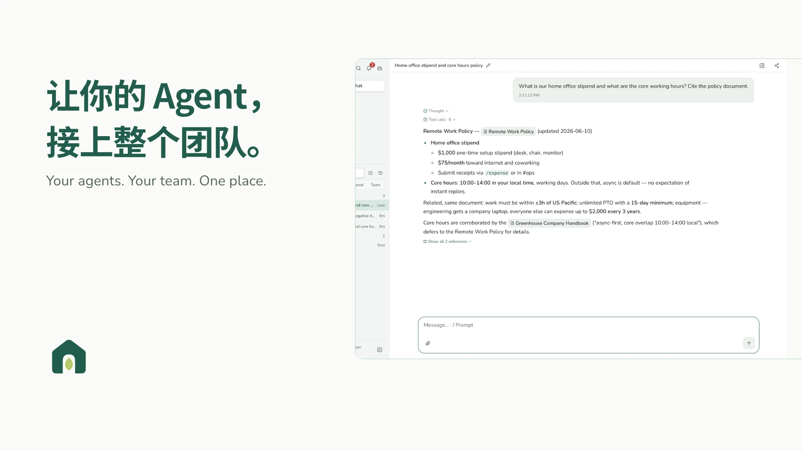
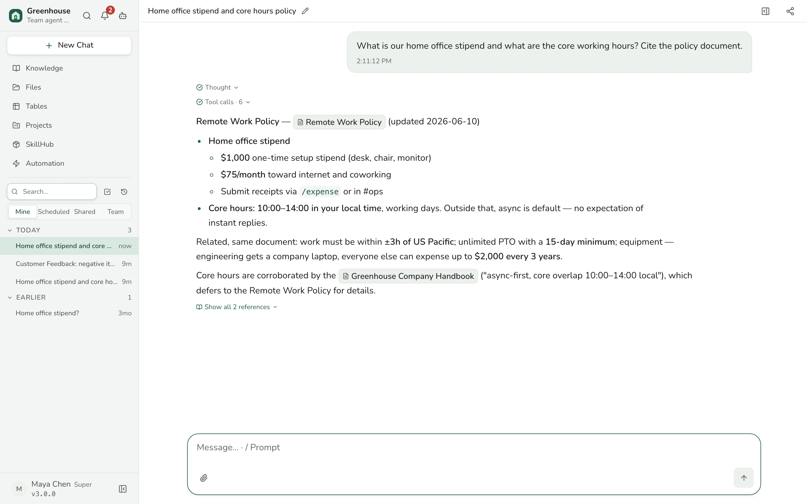
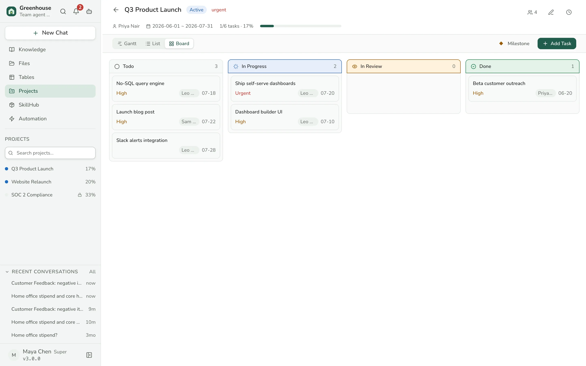
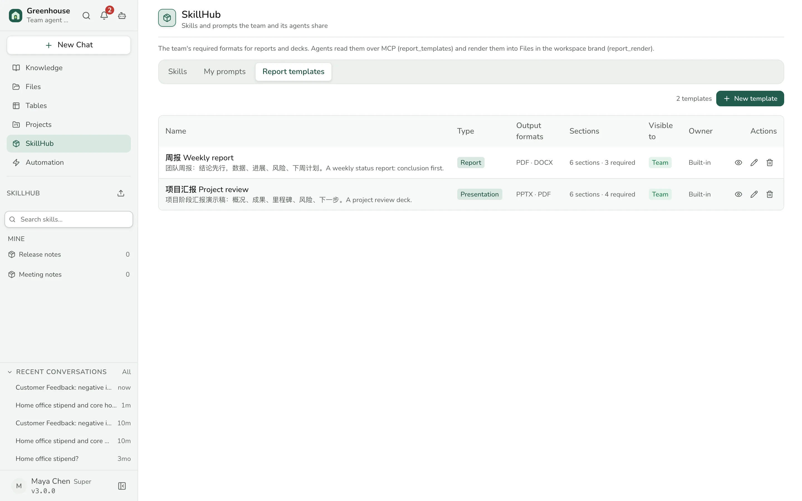
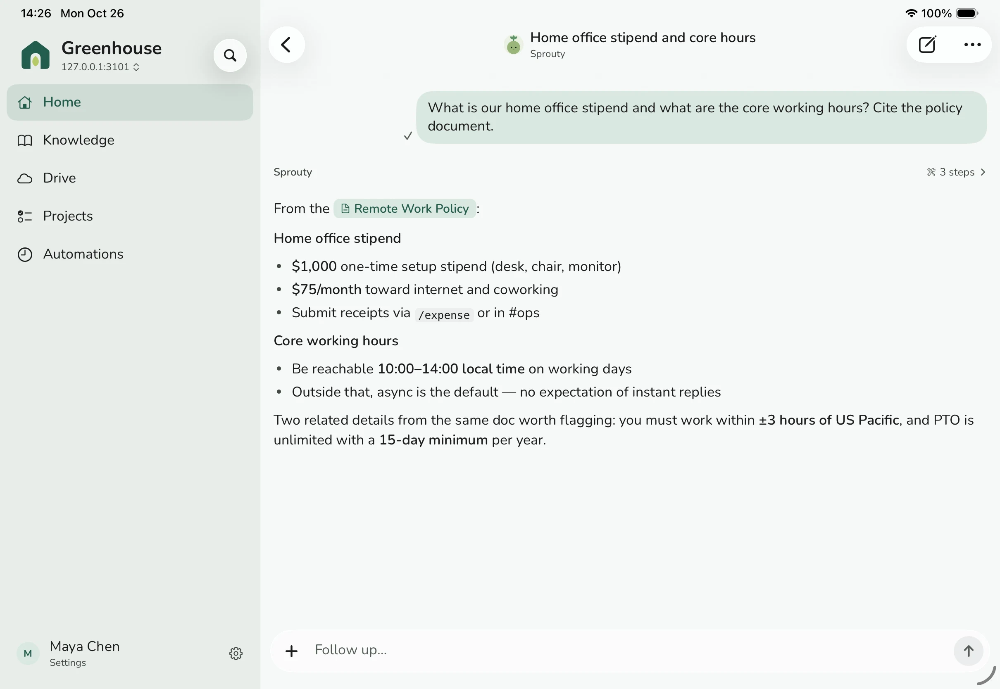
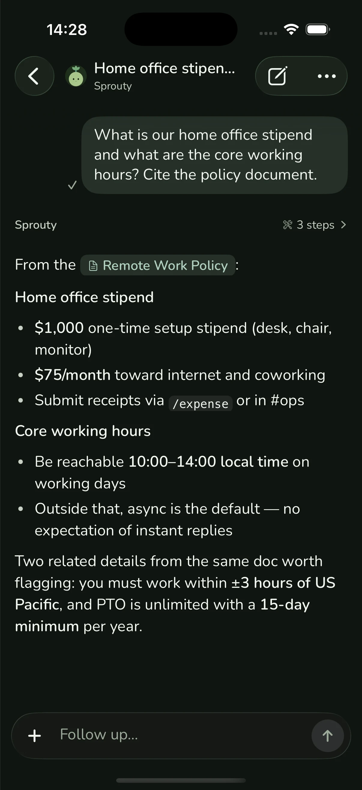

<p align="center">
  
</p>

<h1 align="center">Your agents. Your team. One place.</h1>

<p align="center">
  Connect the agents you love to the knowledge, files and work your team shares.<br>
  Or start a conversation with Sprouty, on the web and iOS.
</p>

<p align="center">
  <a href="https://greenhouse.linjiejim.com">Website</a> ·
  <a href="https://greenhouse.linjiejim.com/#film">Watch the one-minute tour</a> ·
  <a href="#get-started">Get started</a> ·
  <a href="docs/capabilities.md">中文功能说明</a>
</p>

<p align="center">
  <a href="LICENSE"></a>
  <a href="https://github.com/linjiejim/greenhouse/releases"></a>
  <a href="https://github.com/linjiejim/greenhouse/actions/workflows/ci.yml"></a>
</p>

[](https://greenhouse.linjiejim.com/#film)

**Greenhouse is an open-source, self-hosted agent hub for one team.** Members bring Codex,
Claude Code, Cursor or any MCP client. Their agents work with team resources within the member’s
permissions. Sprouty, the built-in assistant, brings the same workspace into a conversation.

- **Give agents the right context.** Knowledge, files, tables, projects, shared skills and report templates in one place.
- **Go from a question to a result.** Search documents, analyze data, update work, generate reports and schedule recurring tasks.
- **Keep the team in control.** Scoped access, recorded MCP writes, deletion previews, and budgets for paid calls.

## A quick look

<table>
<tr>
<td width="50%" valign="top">

<b>Answers with context.</b> Ask Sprouty about team knowledge and see the source behind the answer.
</td>
<td width="50%" valign="top">

<b>Data you can work with.</b> Typed fields, linked records, formulas and views, ready for your agents to query.
</td>
</tr>
<tr>
<td width="50%" valign="top">

<b>Work that moves forward.</b> Projects, tasks, boards, timelines, members and discussion.
</td>
<td width="50%" valign="top">

<b>Results in your team’s format.</b> Shared skills and templates for PDF, Word and PowerPoint reports, saved to Files.
</td>
</tr>
</table>

These are real captures of the current application with the repository’s fictional example
team. Chat answers are produced by a live model. Native iOS captures come from Simulator.
[Capture details and reproduction](docs/assets/screens/README.md).

## What it can do

| Work with… | What you can do |
| --- | --- |
| **Sprouty** | Streaming chat, attachments, model switching, cited answers, charts and tables, shared conversations and confirmation cards. |
| **Knowledge & files** | Search and edit knowledge, manage versions and sharing, upload and organize team and personal files. |
| **Tables & projects** | Structured data with formulas and record links; project lists, boards, timelines, tasks and comments. |
| **Skills & reports** | Versioned skill bundles, reusable prompts and branded PDF / Word / PowerPoint report templates. |
| **Automations** | Schedule assistant runs, grant permitted tools and find results in Scheduled history. Optional Feishu, WeCom and email delivery. |
| **Your agents** | OAuth MCP access to team resources; remote MCP connectors; optional shared model gateway and cloud computer. |
| **Team administration** | Permissions, activity records, paid-service budgets, usage, branding and runtime configuration. |

[Full product guide](docs/product-guide.md) · [中文能力与限制](docs/capabilities.md)

## Get started

Clone the repository, generate secrets and configure your model:

```bash
git clone https://github.com/linjiejim/greenhouse.git
cd greenhouse
cp .env.example .env
./scripts/gen-secrets.sh
# Edit .env: LLM_BASE_URL, LLM_API_KEY, LLM_MODEL
docker compose up -d --build
docker compose exec api pnpm admin:create
```

Open **http://localhost:3000** and sign in with the account you just created.
The Compose stack contains PostgreSQL, a one-shot migration job and the API serving the web app.

**For production, check out a tagged release before building.** To use a prebuilt image,
set `GREENHOUSE_IMAGE` to a specific published 3.x image tag and use
[`docker-compose.ghcr.yml`](docker-compose.ghcr.yml). The release workflow does not move `:latest`.

[Deployment, configuration and upgrades →](docs/self-hosting.md)

## Connect your agent

1. Open **Settings → Agent connections → Connect** in Greenhouse.
2. Pick Codex, Claude Code, Cursor or another MCP client and follow the guide.
3. Authorize the resources the agent needs with your own account.

The MCP endpoint is `https://your-greenhouse.example/api/mcp`. Greenhouse supports OAuth 2.1
with PKCE. An agent’s access is the intersection of your permissions, the granted resource
groups and the granted read/write scope.

MCP writes run as you and are recorded. Delete-like actions return a preview and require a
confirmation round trip. Team knowledge, skills and report templates help every agent work
with the same context.

[Agent access, connectors and model gateway →](docs/agent-access.md)

## Clients

<p align="center">
  
  
</p>

| Surface | What it’s for |
| --- | --- |
| **Web** | The complete workspace, content editing, agent connections and team administration. |
| **iPhone & iPad** | Sprouty, knowledge reading, files, project updates, table browsing, scheduled tasks and notifications. Multiple servers, recent offline content and widgets. |
| **Feishu** | Optional Sprouty bot, account binding and sign-in. Requires configuration. |
| **MCP clients** | Members’ own agents working with authorized team resources. |

The native app does not mirror every web editor. Android has source code but no published
build; there is no desktop app or browser extension in 3.0.
[Client details](docs/product-guide.md#clients) · [Mobile development](apps/mobile/AGENTS.md)

## Permissions and costs

- Agents cannot exceed the member’s access. MCP grants can narrow it further.
- MCP writes identify the member and client. Delete-like actions preview first.
- Paid calls are metered against member, service and team budgets, with alerts at 80% and 100%.
- Model gateway, cloud computer, email, Feishu bot and push require explicit configuration.
- Self-hosting keeps the workspace on your infrastructure. Configured model providers and
  external services process the requests you send them.

## Documentation

| Read | For |
| --- | --- |
| [Product guide](docs/product-guide.md) / [中文](docs/capabilities.md) | Complete capabilities, tools, clients and limits |
| [Self-hosting](docs/self-hosting.md) | Docker, configuration, releases and migrations |
| [Agent access](docs/agent-access.md) | MCP, scopes, model gateway and paid services |
| [Development](docs/development.md) | Local setup, architecture, tests, new tools and applications |
| [Extensions](EXTENDING.md) | Adding private modules through the supported seam |
| [Releasing](RELEASING.md) | Maintainer release runbook |
| [Website & film](docs/assets/screens/README.md) | Reproducing the screenshots and introduction video |

## Development

```bash
pnpm install
pnpm run-dev up
```

The engine starts the local stack, allocates free ports and gives each worktree an isolated
database. See the [development guide](docs/development.md) for prerequisites and test databases.

Run `pnpm typecheck`, `pnpm lint` and `pnpm test` before submitting functional changes.

## Contributing

Use Conventional Commits (`feat:`, `fix:`, `docs:`…). Read [AGENTS.md](AGENTS.md) and the guide
next to the code you change. Pull requests are squash-merged; generic features belong in core,
private modules belong in the extension seam.

## License

[MIT](LICENSE)

<!-- Preserve entry points used by older links. Detailed material now lives in the guides. -->
<a id="architecture"></a><a id="quick-start-local-development"></a><a id="adding-a-tool"></a><a id="adding-an-application"></a><a id="extensions"></a>
[Architecture, local setup and extension development](docs/development.md)

<a id="one-command-docker-deploy"></a><a id="configuration"></a><a id="releases--stability"></a><a id="upgrading-from-1x-to-30"></a><a id="upgrading-within-3x"></a><a id="historical-1x-upgrade-notes"></a>
[Deployment, configuration and upgrading](docs/self-hosting.md)

<a id="mcp--agent-access"></a><a id="model-gateway-members-agents-on-the-teams-models"></a><a id="tools"></a>
[MCP, tools and model gateway](docs/agent-access.md)

<a id="screenshot-tour-visual-smoke-test"></a><a id="database-migrations"></a><a id="backups"></a>
[Screenshots, tests, migrations and backups](docs/development.md#development)
