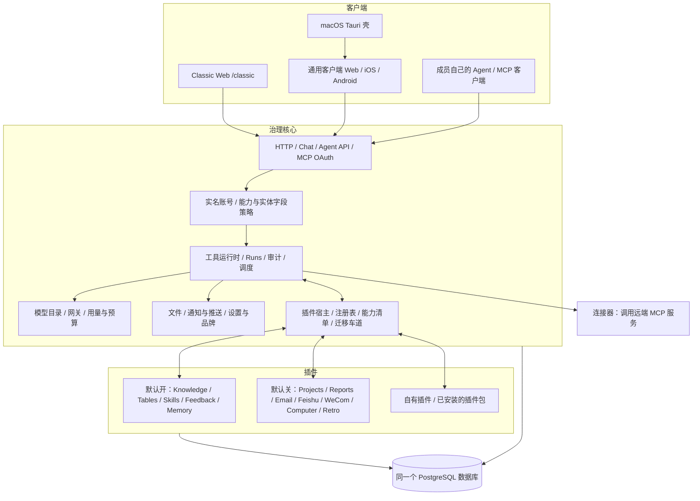
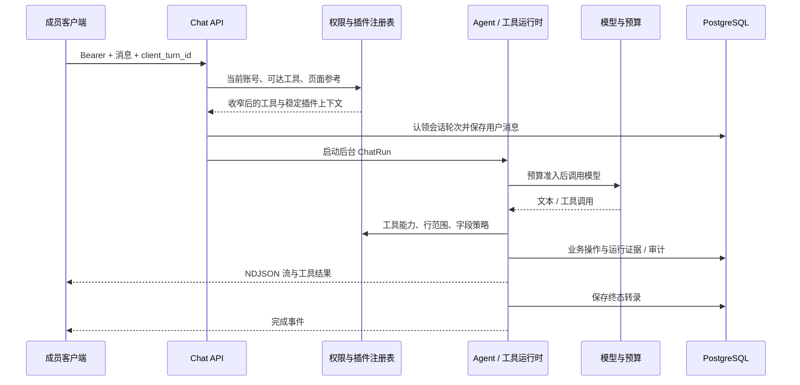
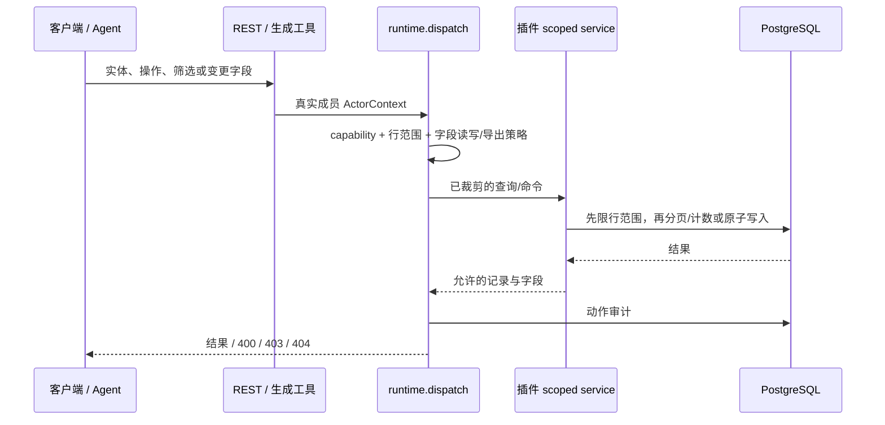
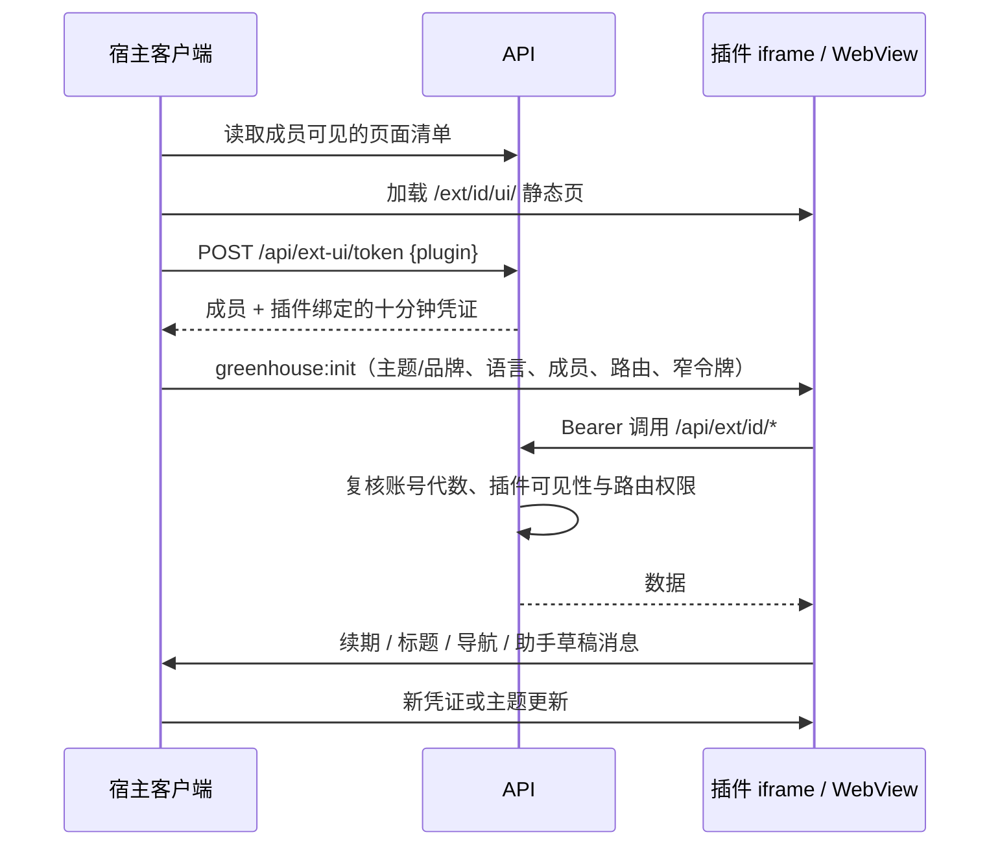

# Greenhouse 4.0 架构

Greenhouse 是团队自托管的 Agent 中台。成员在应用里使用 Sprouty，也可以把自己的 Agent
通过 MCP 接进来。两者使用同一个工具目录、同一套权限与预算。4.0 将业务能力交给插件，
核心负责身份、分配、运行、分发与审计。

本文描述当前代码；可用功能见[能力范围](capabilities.md)，插件开发见 [EXTENDING.md](../EXTENDING.md)。

## 三环结构

核心保留对话、Agent 配置、模型与付费服务、文件、自动化、通知、接入、审计、用量、设置、
管理后台和 CLI。保存的提示词也在核心；SkillHub 只拥有技能包目录、版本、安全扫描与相关工具。

官方插件与自有插件使用相同的 kit 和导入守卫。默认构建包含十二个官方插件及 Example 参考包，
运行时只启用五个默认插件。Retro 依赖 Knowledge。关闭插件会撤下其工具、接口、页面与注册项，
数据仍留在原表中。

## 装配与发现

`greenhouse.config.ts.plugins` 决定构建包含哪些包；`pnpm plugins:sync` 生成 API 和 classic
两端的静态注册文件。`extensions.enabled` 决定进程启用哪些 id，环境变量
`GREENHOUSE_EXTENSIONS` 可覆盖。新增编译包要重建，启停要重启，没有热装载或数据库开关。

每个插件的 `manifest.ts` 是纯数据，描述版本、SDK、依赖、能力与界面。鉴权后的
`GET /api/extensions` 返回按当前成员裁剪的 v2 清单，包含导航、页面、实体、字段与动作，
并保留 v1 的 `extensions` / `entityKinds` 字段。SDK 2 是当前版本，SDK 1 在 4.x 继续兼容。

`/api/bootstrap` 在登录前提供品牌与 `mobile_api: 4`。当前通用客户端最低要求仍为 3，
能够在没有 v2 清单的旧站点回退到旧导航；服务端清单不会代替请求时的鉴权。

## 客户端与托管

Classic Web 在本候选版默认占据 `/`，两种托管模式都保留 `/classic/`。配置
`clients.web: 'universal'` 后，根路径服务 Expo 导出的通用客户端，管理后台仍可从 classic 打开。
`pnpm dev` 使用 Vite 开发 classic；`pnpm web:build` 与 `pnpm app:build` 分别构建两套静态产物。
Docker 使用独立构建阶段安装 Expo 自己的锁文件，运行镜像由 API 统一托管两套客户端。

通用客户端按站点清单显示主要入口与「更多」。官方 `native` 页面有编入客户端的适配器；
数据插件复用实体列表、详情和表单渲染器；设置页复用已声明的 Runtime Config 字段。
无法识别的页面使用经过校验的浏览器回退地址。macOS 只补原生窗口、菜单、通知、快捷键与
Keychain，会话与业务逻辑复用通用客户端。

## 一轮对话的数据流

插件的 Agent 提示片段只在成员能用到它的工具时注入，每个片段上限 2,000 字符；MCP
资源和提示词也按可达范围筛选。页面上下文是参考，不授予权限。付费调用先占预算，完成后
记录实际用量。断线不终止生成，可按序号续读；终态转录先落库，再关闭运行流。

MCP 工具调用先经过 OAuth 成员、动作范围与资源分组交集，再进入同一个工具层。MCP 写入
记为成员名下的运行，删除先预览；Agent API 每次写入要求确认。平台动作统一留审计，
Agent API 的普通调用另记请求日志，不应把所有传输日志都描述成 Agent 写入记录。

## 一次数据插件请求

`dataSources` 复用平台 DSL，派生应用、角色能力、功能点、MCP 分组、工具、CRUD REST、目录、
搜索、导出、深链 peek 和实体页，不生成数据库 DDL。自定义处理器应复用已限范围的 service；
外部数据处理器需自行保证同等权限与事务正确性。

写入采用声明与成员字段策略的交集。id、存储元数据时间、内部/机密/受限字段与明确只读字段，
管理员也不能作为输入修改。owner/member 要显式开放写入；创建先校验再盖调用者归属。
非法字段整次拒绝并列出名称。客户端更新只发送变化的可写字段，列表刷新保留当前记录与分页。

## 一次内嵌页面访问

`@greenhouse/ui-tokens` 从唯一主题源生成浅/深色 token，并提供 `connectGreenhouse`。
双方校验消息来源窗口与精确 origin。凭证只允许所属插件 API 与基础 `GET /api/me`，不能调用
别的核心接口或自签续期；更新由持有完整登录态的宿主完成。`sendPrompt` 只打开可编辑草稿。

静态 UI 公开托管，不含用户数据或凭证。可信插件 iframe 允许脚本与同源访问，因此其安全基础是
安装代码的信任，不是防恶意插件的沙箱。普通用户 HTML 预览保持不透明 origin，永不接收登录态。
CSP 允许同源和精确的 `tauri://localhost` 父级；桌面内嵌页没有原生能力。跨站点内嵌授权未实现。

## 目录与数据库归属

| 路径 | 归属 |
|---|---|
| `apps/api/src/` | 核心鉴权、Chat、工具运行时、插件宿主、调度、接入与 CLI |
| `apps/web/src/` | Classic shell、管理后台、共享组件与插件页面宿主 |
| `apps/mobile/` | 独立 Expo 工作区；原生/网页适配、`src/plugins/<id>/` 与 vendored 协议 |
| `apps/desktop/` | Tauri macOS 壳与构建脚本 |
| `packages/agent-core/`、`packages/platform-kernel/` | 模型循环与平台权限原语 |
| `packages/db/` | 核心 schema、服务、迁移与 1.x carry |
| `packages/types/`、`packages/utils/` | 共享协议与基础函数 |
| `packages/crud/`、`packages/ui/`、`packages/ui-tokens/` | CRUD、主题/共享 UI 与内嵌桥 |
| `packages/knowledge-editor/` | 共享编辑器 schema 与 Markdown 转换 |
| `plugins/<id>/` | 纯清单、API/web、业务 schema/service、迁移、测试及可选静态 UI |
| `drizzle/` | 核心不可变基线与后续迁移；插件 DDL 不加入这里 |

同一个库内，核心 schema 管 49 张表，十个官方数据插件管 24 张表；Example 表与插件迁移账本
另计。不可变的 3.0 基线仍会在全新库建出原有 73 张表，即使禁用业务插件也可能留下空表。
4.0 的归属迁移只推进快照，插件通过幂等 adoption 认领原表，不搬家、不删行。

插件可以引用核心表，核心不得新增指向插件表的外键。通知类型、文件关联类型、目录 scope、
运行类型等开放判别值由启用注册表校验；历史读取不因停用而丢失。
`extension_migrations` 记录 SQL 校验和及安装标记。已应用文件不得修改。
停用保留表；显式 `pnpm cli plugins drop <id>` 才预览删除，`--yes` 执行，遇外部依赖以
RESTRICT 拒绝。详细表目录见[数据库结构](../packages/db/src/db-schema.md)及各插件 schema 文档。

## 安全与运行边界

- 所有业务入口绑定有效的内部 team/super 账号；MCP 授权只能收窄成员权限。
- 进程内插件拥有进程和数据库权限；代码审查、依赖锁定、kit 边界与 overlay 守卫是信任基础。
- 插件包不能深导入核心，核心不能引用业务插件；新增通用能力通过注册表和参考用例落地。
- 密钥只经受保护的配置/加密服务读取，静态资产、日志、审计元数据与消息桥不得携带完整凭证。
- 观察事件只带 id/metadata，异步、不可否决、五秒超时；消费者须能承受重试。
- `onInstall` 在迁移后加锁执行，成功记账；崩溃可能重入，副作用必须幂等。
- 计划任务使用持久运行与单实例认领；已执行一部分的 Agent 运行不能自动重放整轮。
- Chat 活跃运行、编辑 presence 与部分外部 token/cache 仍在进程内；多副本不能仅凭有数据库就视为全面支持。
