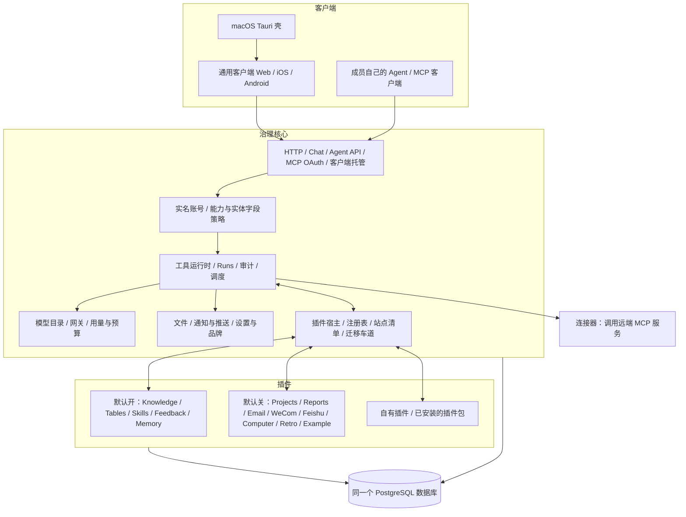
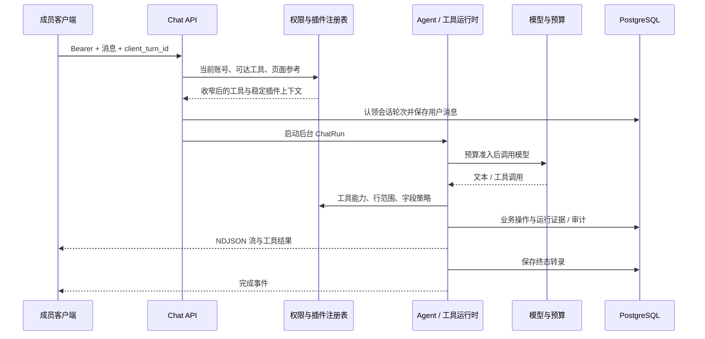
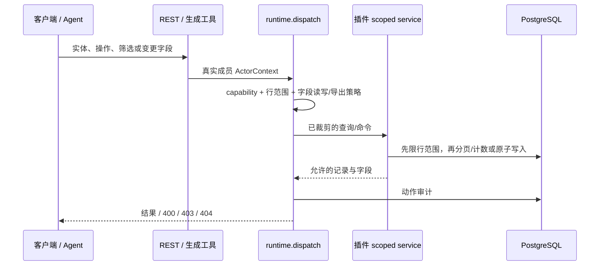
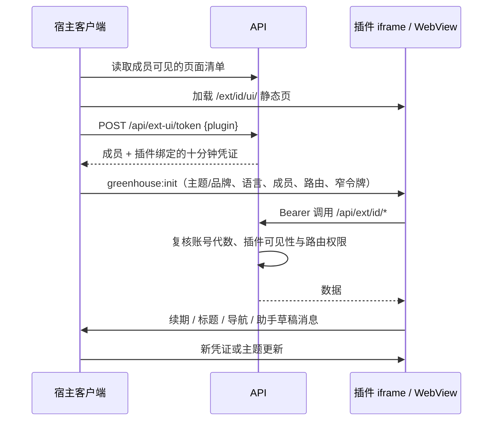

# Greenhouse 4.0 架构

Greenhouse 是团队自托管的 Agent 中台。成员在客户端里使用 Sprouty，也可以把自己的 Agent
通过 MCP 接进来，两者使用同一个工具目录、同一套权限与预算。业务能力由插件提供，
核心负责身份、分配、运行、分发与审计。

本文描述当前代码；可用功能见[能力范围](capabilities.md)，插件开发见 [EXTENDING.md](../EXTENDING.md)，
从 3.x 升级见[升级到 4.0](upgrading-to-4.0.md)。

## 三环结构

核心保留对话与自定义 Agent、模型与付费服务、文件、自动化、通知、接入、审计、用量、设置、
管理接口和 CLI；保存的提示词（`/api/prompts`、`task_capture`）也在核心。官方插件与自有插件
使用同一个 kit、导入守卫和迁移车道。默认构建编入十二个官方插件和 Example 参考包，只启用五个；
Retro 依赖 Knowledge。关闭插件会撤下其工具、接口、页面与注册项，数据留在原表。

## 装配与发现

插件包 `plugins/<id>/`：`package.json` 的 `greenhouse` 字段声明 id、`sdk: 2` 与 API 入口；
`manifest.ts` 是纯数据（版本、`core` 范围、依赖、功能点、导航与页面、可选静态 `ui`）；
`api/index.ts` 用 `@greenhouse/api/extension-kit` 的 `defineExtension` 声明工具、路由、数据源与
任务；`migrations/` 是自己的迁移车道。插件不向客户端编入代码，客户端只按清单渲染。

`greenhouse.config.ts.plugins` 决定编入哪些包；`pnpm plugins:sync` 校验包元数据，只生成
`apps/api/src/plugin-host/compiled.generated.ts`（不提交，安装、开发、测试与 CLI 自动运行）。
宿主只接受 SDK 2，缺少 `sdk` / `core` 或版本不符都拒绝激活。`extensions.enabled` 决定启用
哪些 id，`GREENHOUSE_EXTENSIONS` 可覆盖；改编入列表要重建，启停要重启，没有热装载。宿主
`apps/api/src/plugin-host/` 聚合启用插件的注册表、运行数据源并生成站点清单；MCP / OAuth 授权
原语在 `apps/api/src/agent-access/oauth.ts`。

鉴权后的 `GET /api/extensions` 返回按成员裁剪的 v2 站点清单：导航、页面、实体、字段（含可写
标记）与动作。页面有 `native`、
`entity-list`、`entity-detail`、`settings-form`、`embed` 五种；`parent: 'administration'` 的
native 页面或设置表单是 Admin 分区，只发给 super。清单只决定显示什么，请求时仍逐次鉴权。
`/api/bootstrap` 在登录前提供品牌与 `mobile_api: 4`（`CLIENT_API_LEVEL`）；客户端同样要求 4
（`apps/client/src/api/bootstrap.ts`），低于它的 3.x 工作站只显示「需要升级」。

## 客户端与托管

唯一的客户端是 `apps/client`（Expo：Web、iOS、Android），不在 pnpm 工作区内，用
`pnpm client:install` 单独安装，共享协议以 vendored 副本保存并有一致性测试。`pnpm dev` 启动
API 与 Expo Web；`pnpm app:build` 把 Web 导出到 `public/app`，API 在 `/` 托管
（`apps/api/src/hosting.ts`），`/api`、`/ext`、`/oauth`、`/.well-known` 与 `/health` 不回落到页面。Docker 镜像只带这一套客户端；配置里写 `clients.web` 会启动报错。

宽屏 Web 的 rail 依次是内置位置（对话、知识库、云盘、表格、项目、自动化，其中三项随插件与权限
出现）、「更多」浮层里的插件入口，super 在底部多一个 Admin；⌘K 与桌面 Go 菜单共用这份列表。
新建与编辑用固定尺寸的居中对话框（`DIALOG_SIZES` sm / md / lg / xl）；设置是居中窗口，只放个人
设置（偏好、账号、我的 Agent、连接、站点）。界面规则见 [apps/client/DESIGN.md](../apps/client/DESIGN.md)。
Admin 位置 `/admin` 只给 super，只在浏览器与桌面端的宽窗口可用。核心分区固定 11 个（`apps/client/src/admin/sections.ts`）：
成员、操作记录、客户端错误、用量、服务与计价、团队上下文、品牌、运行时配置、MCP 接入、团队连接器、插件；
插件分区来自清单：Feedback 的问题与需求、Retro 的月度复盘、Computer 的云电脑管理，全开时共 14 个。

服务端链接来自 `@greenhouse/types/client-routes`，一次性凭证只放在 URL 片段。入口页有 `/activate`、
`/oauth-consent`、`/connectors/oauth-finish`、`/bindings`，飞书登录回到 `/login`，会话通知链到
`/chat?session=`。浏览器地址栏里的旧 `#/…` 地址不再映射，打开即回首页；内容里的 `#/…` 对象链接
仍在应用内打开。

官方 `native` 页面有编入客户端的适配器（`apps/client/src/plugins/<id>/`）：知识库、表格、项目是完整
位置，其余是只读列表或专用页面。数据插件复用实体列表、详情和表单渲染器，`user` 字段经
`POST /api/people/resolve` 显示成员名；设置表单复用 Runtime Config 字段；`embed` 加载插件静态 UI。
`apps/desktop` 是 Tauri 2 macOS 壳，打包同一份 Web 导出，补原生窗口、菜单、通知、Quick ask、
Keychain 与多站点。

## 一轮对话的数据流

插件的 Agent 提示片段只在成员能用到它的工具时注入，每段上限 2,000 字符；MCP 资源和提示词也按
可达范围筛选。页面上下文是参考，不授予权限。付费调用先占预算，完成后记实际用量。断线不终止生成，
可按序号续读；终态转录先落库，再关闭运行流。MCP 调用先取 OAuth 成员、动作范围与资源分组的交集，
再进入同一个工具层；MCP 写入记为成员名下的运行，删除先预览；Agent API 每次写入要求确认。

## 一次数据插件请求

`dataSources` 复用平台 DSL，派生应用、角色能力、功能点、MCP 分组、工具、CRUD REST、目录、搜索、
导出、深链 peek 和实体页，不生成 DDL。写入取声明与成员字段策略的交集：id、存储时间戳、
内部/机密/受限与只读字段谁都不能写；owner/member 要显式开放；非法字段整次拒绝并列出名称。
客户端更新只发送变化的可写字段。

## 一次内嵌页面访问

`@greenhouse/ui-tokens` 生成浅/深色 token 并提供 `connectGreenhouse`；双方校验来源窗口与精确
origin。凭证只允许所属插件 API 与 `GET /api/me`，续期由持有完整登录态的宿主完成；`sendPrompt`
只打开可编辑草稿。静态 UI 公开托管、不含用户数据；可信插件 iframe 允许脚本与同源访问，安全基础
是对安装代码的信任。普通 HTML 预览保持不透明 origin。CSP 只允许同源和 `tauri://localhost` 父级。

## 目录与数据库归属

| 路径 | 归属 |
|---|---|
| `apps/api/src/` | 核心鉴权、Chat、工具运行时、调度、接入、客户端托管与 CLI |
| `apps/api/src/plugin-host/` | 插件宿主：装配、兼容检查、注册表、数据源运行时、站点清单；kit 入口 `extension-kit.ts` |
| `apps/client/` | 独立 Expo 工作区：位置、Admin、入口页、`src/plugins/<id>/` 适配器与 vendored 协议 |
| `apps/desktop/` | Tauri macOS 壳与构建脚本 |
| `packages/agent-core/`、`packages/platform-kernel/` | 模型循环与平台权限原语 |
| `packages/db/` | 核心 schema、服务与迁移链（3.x 链归档在 `migrations/archive-3x/`） |
| `packages/types/`、`packages/utils/`、`packages/knowledge-editor/` | 共享协议（含站点清单与 client-routes）、基础函数、编辑器 schema 与 Markdown 转换 |
| `packages/crud/`、`packages/ui/`、`packages/ui-tokens/` | CRUD 协议与服务端路由；主题、品牌与植物头像；生成主题与内嵌桥 |
| `plugins/<id>/` | 纯清单、API、业务 schema/service、迁移车道、种子、测试及可选静态 UI |
| `tests/` | 共享 API / DB / e2e 测试层；`tests/client-e2e/` 是客户端 Playwright 用例 |

核心 schema 管 49 张表（`packages/db/migrations/0000_v4_baseline.sql`，含插件迁移账本
`extension_migrations`）；十个官方数据插件在启用时经各自车道（`0001_adopt.sql`）建 24 张表，
Retro 与 WeCom 没有表，Example 的表另计。3.x 库由 `pnpm db:migrate` 原地桥接：跑完归档链、记下
4.0 基线，插件车道幂等认领原表，不搬家、不删行；未桥接的 3.x 库 API 拒绝启动。1.6 须先经 3.0.2 再升级；2.x 库没有升级路径。
插件可以引用核心表，核心不新增指向插件表的外键。开放判别值由启用注册表校验，历史读取不因停用
而丢失。已应用的迁移文件不得修改。停用保留表；`pnpm cli plugins drop <id>` 先预览，`--yes` 执行，
遇外部依赖以 RESTRICT 拒绝。表目录见[数据库结构](../packages/db/src/db-schema.md)及各插件 schema 文档。

## 安全与运行边界

- 所有业务入口绑定有效的内部 team/super 账号；MCP 授权只能收窄成员权限。
- Admin 接口与设置写入只对 super 开放；清单裁剪不代替接口鉴权。
- 进程内插件拥有进程和数据库权限，信任基础是代码审查、依赖锁定、kit 边界与 overlay 守卫；
  插件不能深导入核心，核心不引用业务插件，通用能力通过注册表和参考用例落地。
- 密钥只经受保护的配置/加密服务读取，静态资产、日志、审计元数据与消息桥不得携带完整凭证。
- 观察事件只带 id/metadata，异步、不可否决、五秒超时；`onInstall` 迁移后加锁执行，副作用必须幂等。
- 计划任务使用持久运行与单实例认领；已执行一部分的 Agent 运行不自动重放整轮。
- Chat 活跃运行、编辑 presence 与部分外部 token/cache 在进程内；多副本需要额外设计。
