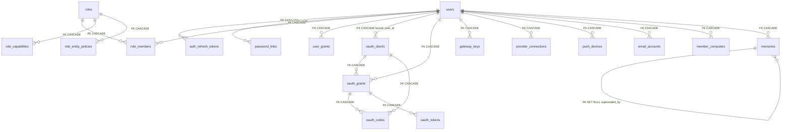
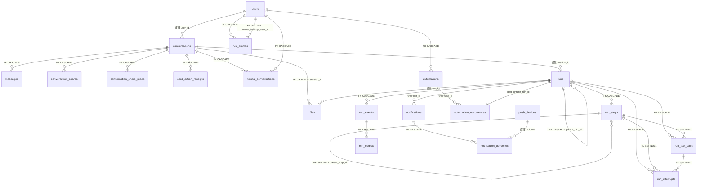
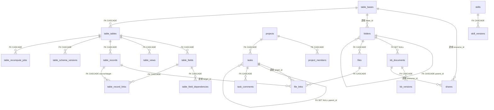
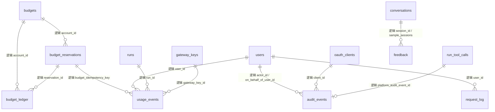

# 数据库结构（PostgreSQL，3.0）

> 事实源：`packages/db/src/schema/*.ts`（每个域一个文件，文件头写着本域的表）。迁移链从 `drizzle/0000_v3_baseline.sql` 起步；1.x 的 0000–0013 归档在 `drizzle/archive-1x/`，只用来识别 1.x 库。
>
> 当前共 **72 张表**。字段类型、默认值、索引以 schema 与最新 snapshot 为准；本文只写用途、关键列和关系。

## 设计约定

- 主键一律 `text`。新行用 `newId(kind)`（`ids.ts`，类型前缀 + ULID，如 `doc_01J…`）；从 1.x 搬来的行保留原 id，整数变成十进制字符串。id 是不透明键，不按形状判断任何事。
- 1.x 里是 serial 的表（会话、消息、项目、任务、文档……）新旧 id 混排，`ORDER BY id` 没有时间含义；按 `created_at`（或 `seq` / `position` / `sort_order`）排序。
- 边界（路由、工具、MCP）接受旧的数字 id：`toRowId()`（`@greenhouse/utils/id`）或 zod `z.coerce.string()` 规范成字符串。
- JSON 一律 `jsonb NOT NULL`，默认 `{}` / `[]`（`_columns.ts` 的 `json()`）；只有「null 本身有含义」才用可空的 `jsonOrNull()`。
- 时间点 `timestamptz`，按 ISO 字符串读；`created_at` / `updated_at` 为 `NOT NULL DEFAULT now()`。业务日期（项目 / 任务的 start / end / due）用 `date`（`YYYY-MM-DD`）。
- 枚举是 `text` + CHECK 约束（`oneOf()`），类型层同时用 `text(..., { enum })` 标注。
- 外键只用于同域强归属，并写明 `CASCADE` / `SET NULL`；审计、用量、通知、运行类表只存逻辑引用，主体删除后记录照留。
- 单组织：没有 organizations 表、没有 `org_id` 列。platform kernel 的 `ActorContext.orgId` 保留，宿主固定传 `'default'`。
- 一个概念一张表，合并来源用判别列区分（见「合并表与判别列」）。
- 软删分三种：`archived_at`（可见可恢复）、`deleted_at`（带回收站）、其余硬删 + 级联。
- 密钥在 `_enc` 列（AES-256-GCM，`PROVIDER_TOKEN_ENCRYPTION_KEY`）；令牌、授权码、网关 Key、设密链接只存 SHA-256。
- `messages.seq` 在锁定对应 `conversations` 行后分配，UK `(session_id, seq)` 兜底。
- 高增长表有保留期，由每日清理执行（见「保留期」）。

## 表目录

### 身份（identity.ts）

| 表 | 主键 / 唯一 | 用途与关键列 |
|---|---|---|
| `users` | PK `id`；UK `email` | 内部账号。`role` super / team（`external` 只出现在搬来的 disabled 行，鉴权拒绝）；`status` invited / active / reset_required / disabled；`auth_version` 凭证代数（改密、停用时递增，令牌与推送设备比对）；`locale`；`preferences` jsonb（字号 `fontScale`、Home 工作台 `workbench`） |
| `auth_refresh_tokens` | PK `id` | 刷新令牌 hash、签发代数、过期时间；FK `user_id` CASCADE |
| `password_links` | PK `id`；UK `token_hash`；部分 UK `user_id`（未消费未撤销） | 邀请 / 重置设密链接，只存 token 的 SHA-256；`purpose`、`issued_auth_version`、过期 / 消费 / 撤销、邮件投递状态；`created_by` 逻辑 |
| `login_states` | PK `id`（= 值的 SHA-256） | 飞书 / 企微登录的待回调 `state` 与一次性登录码；`provider`、`kind` pending / login_code、`payload`、`expires_at`、`consumed_at` |
| `rate_limits` | PK `key` | 固定窗口计数，`key` = `<规则>:<主体>:<窗口起点 ms>`；`count`、`expires_at` |

### 权限（access.ts）

| 表 | 主键 / 唯一 | 用途与关键列 |
|---|---|---|
| `roles` | PK `id`；UK `code` | 角色；`status`、`system_protected` |
| `role_members` | PK `(role_id, user_id)` | 角色成员；两列都 FK CASCADE |
| `role_capabilities` | PK `(role_id, capability)` | 角色授予的能力（由核心与扩展 manifest 声明） |
| `role_entity_policies` | PK `id`；UK `(role_id, app_id, entity_id)` | 角色的实体策略：`scopes`（own / assigned / all）、`field_policies`；CRM 经 `db.platform` 求值 |
| `user_grants` | PK `(user_id, kind, key)` | 每成员开关：`kind=feature`（FEATURE_FLAGS 键，`enabled=false` = 显式关闭默认开启的 flag）/ `kind=tool`（可选工具，有行即授予）；`config` |

权限判定：角色 allow > 默认 deny。没有个人级能力 / 实体策略覆盖。

### 外部 Agent 与第三方连接（oauth.ts）

| 表 | 主键 / 唯一 | 用途与关键列 |
|---|---|---|
| `oauth_clients` | PK `id` | MCP / Agent 代理的 OAuth 2.1 客户端；`redirect_uris`、认证方式、`client_secret_hash`、`bound_user_id`（机器客户端代表的成员，FK CASCADE）、`allowed_scopes`、`status` |
| `oauth_grants` | PK `id`；UK `(user_id, client_id, resource)` | 成员对客户端的授权；`scopes`（实际授予，读时不放宽）、`status`、`avatar`（成员给这个 Agent 选的植物头像 `{plant, tint}`，null = 客户端默认） |
| `oauth_codes` | PK `code_hash` | 授权码（只存 hash）；PKCE S256、`redirect_uri`、`resource`、`scopes`、`used_at` |
| `oauth_tokens` | PK `id`；UK `token_hash` | access / refresh 令牌 hash；`resource`、`scopes`、过期 / 撤销 / 最近使用 |
| `gateway_keys` | PK `id`；UK `key_hash` | 成员的模型网关 Key；`key_prefix`、`allowed_models`（null = 全部）、过期、撤销（只打 `revoked_at`） |
| `provider_connections` | PK `id`；UK `(user_id, provider, workspace_id)` NULLS NOT DISTINCT | 成员与飞书 / 企微等的绑定；`access_token_enc` / `refresh_token_enc` / `credential_enc`（身份型绑定为 null）、`provider_user_id`（企微 UserId / 飞书 open_id，个人推送收件人与扫码登录查表键）、`metadata` |

### 对话（conversations.ts）

| 表 | 主键 / 唯一 | 用途与关键列 |
|---|---|---|
| `conversations` | PK `id` | 会话；`profile_id` 默认 `team`、`user_id`（逻辑）、`app_id`、`channel`（web / task / feishu / mobile…）、`metadata`；`pinned_at` + `pin_position` 为 owner 的置顶；`digest` / `digest_upto_seq` / `digest_updated_at` 滚动摘要 |
| `messages` | PK `id`；UK `(session_id, seq)` | 消息；`content` 为 Markdown 正文，`parts` jsonb `{references, images, pipeline}`（引用、图片、工具步骤与富卡片），`reasoning`、`model`、token 与耗时 |
| `conversation_shares` | PK `id`；UK `(session_id, shared_with)` | 会话共享；`shared_with` = 成员 id 或 `__team__` |
| `conversation_share_reads` | PK `id`；UK `(session_id, user_id)` | 收件人在共享会话上的状态：`read_at`，以及自己的置顶 `pinned_at` / `pin_position` |
| `card_action_receipts` | PK `id` | 卡片按钮的 exactly-once 回执（`tables_schema_plan` / `task_capture`）；`request_hash`、`status`、`result` |

### 运行（runs.ts）

Chat 与 Automation 共用的执行内核：Run / Step 走 version CAS，worker 用 `FOR UPDATE SKIP LOCKED` + lease 领取，状态变化与 Event + Outbox 同事务提交。`kind` 里 workflow / mission / subagent / eval 只剩历史行。

| 表 | 主键 / 唯一 | 用途与关键列 |
|---|---|---|
| `runs` | PK `id`；UK `(kind, source_kind, source_id)`；部分 UK `(owner_user_id, kind, idempotency_key)` | 执行 envelope；主体 / 来源 / `parent_run_id` / `root_run_id`、`status`、`desired_state`、优先级与时限、lease / heartbeat、attempt、`input` / `output` / error、`version` |
| `run_steps` | PK `id`；UK `(run_id, step_key, attempt)` | 领取与重试单位；lease、用量（tokens / requests / cost_micros）、耗时 |
| `run_tool_calls` | PK `id`；部分 UK `(run_id, idempotency_key)` | 工具调用；完整参数 / 结果、`canonical_input_hash`、`risk_level`、`status`（含 `uncertain`）、`interrupt_id` / `platform_audit_event_id`（逻辑） |
| `run_interrupts` | PK `id` | 审批、ask_user、预算、外部依赖、未知结果等外部决定；`assignee_user_id`、`decision`、`decided_by_user_id` |
| `run_events` | PK `id`；UK `(run_id, seq)`；部分 UK `(run_id, idempotency_key)` | append-only 时间线；`seq` 锁 Run 后分配；`step_id` / `actor_user_id` 逻辑 |
| `run_outbox` | PK `id`；UK `(event_id, topic)` | Event 的投递状态；lease、attempts、dead_letter |

运行产出的文件在 `files`（`source='run'`）。

### 自动化与 Agent 配置（automations.ts）

| 表 | 主键 / 唯一 | 用途与关键列 |
|---|---|---|
| `automations` | PK `id` | 成员的定时任务；`profile_id`、`task_prompt`、cron `schedule` + `timezone`、`notify` jsonb `{webhook, email, wecom, feishu}`、`quiet_when_empty`、`unattended_tools`、`last_status` / `next_run_at` / `run_count` |
| `automation_occurrences` | PK `runtime_run_id` | 自动化 Run 终态的一次性投影（幂等键 = run id）；`task_id` / `owner_user_id` 逻辑 |
| `run_profiles` | PK `id`；UK `(user_id, slug)` | 成员的自定义 Agent（`custom:<id>`）：`base_profile_id`、`model_id`、`tools`、`system_prompt`、`is_shared`（只有 super 能开）、`avatar`、purpose / audience / `risk_level` / `budget_policy`、`owner_backup_user_id`（FK SET NULL）；`version` 只计编辑次数，`custom:<id>@<n>` 解析到当前配置 |

### 知识库（knowledge.ts）

| 表 | 主键 / 唯一 | 用途与关键列 |
|---|---|---|
| `kb_documents` | PK `id`；UK `(doc_id, scope)` | 文档；`content`（Markdown 为准）+ `content_json`（Tiptap）、`visibility` team / private + `owner_user_id`、`status`、`is_template`、`tags`、`meta`、`folder_id`（FK SET NULL，`folders.scope='kb'`）、`sort_order`；`_summary` / `_questions` / `_topics` 富化；检索列 `search_a/b/c` + 生成列 `search_tsv`（GIN） |
| `kb_versions` | PK `id`；UK `(doc_id, version)` | 不可变版本历史；FK `doc_id` CASCADE |

文档的单人分享在 `shares`（`resource_type='kb_document'`）。

### 目录、文件与共享（files.ts）

| 表 | 主键 / 唯一 | 用途与关键列 |
|---|---|---|
| `folders` | PK `id` | 每个 scope 一棵树：`kb`（`visibility` + `owner_user_id`）、`tables`（`base_id`）、扩展 scope（`owner_key`，由扩展鉴权）；`parent_id` 自引用 CASCADE；`sort_order`（0 = 没手排过）。CHECK `chk_folders_scope_owner` 约束三种形状 |
| `files` | PK `id`；部分 UK `storage_key` | 所有存储对象的唯一登记处。`source`：`drive`（scope / folder / visibility / owner / base / owner_key）、`chat_upload` / `chat_output`（`session_id` FK CASCADE）、`run`（`run_id` 逻辑，`meta` 记方向 / kind / path / step）；`status` pending / active / failed / skipped / deleted；`size`、`sha256`、`storage_key`。CHECK `chk_files_source_owner` |
| `file_links` | PK `(file_id, target_type, target_id, slot)` | 附件关系；`target_type` table_record / message / task / kb_document（逻辑），`slot` = 表格字段 id 或 `''`；FK `file_id` CASCADE |
| `shares` | PK `id`；UK `(resource_type, resource_id, principal_type, principal_id)` NULLS NOT DISTINCT | 单独分享：`resource_type` kb_document / folder / file / table_base，`principal_type` user / team，`role` reader / editor（kb）或 owner / builder / editor / viewer（表格库） |

### 项目（projects.ts）

| 表 | 主键 / 唯一 | 用途与关键列 |
|---|---|---|
| `projects` | PK `id` | 项目；`status`、`priority`、`owner_id`（逻辑）、`start_date` / `end_date`（date）、`visibility` |
| `project_members` | PK `id`；UK `(project_id, user_id)` | 成员与角色；FK `project_id` CASCADE |
| `tasks` | PK `id` | 任务；`parent_id` 自引用 SET NULL、`status`、`priority`、`assignee_id`（逻辑）、`start_date` / `due_date`（date）、`tags`、`dependencies`（任务 id 数组） |
| `task_comments` | PK `id` | 任务评论；FK `task_id` CASCADE |

项目与任务的动态写在 `audit_events`（`app_id='projects'`）。

### 表格（tables.ts）

| 表 | 主键 / 唯一 | 用途与关键列 |
|---|---|---|
| `table_bases` | PK `id` | 表格库；`visibility` private / team、`owner_id`、`archived_at`；成员在 `shares`（`resource_type='table_base'`） |
| `table_tables` | PK `id`；UK `(base_id, name)` | 数据表；`position`、`schema_revision`、`archived_at` |
| `table_fields` | PK `id`；UK `(table_id, name)`；部分 UK 主字段 | 字段；`type`（17 种）、`required`、`is_primary`、`config`、`archived_at` |
| `table_field_dependencies` | PK `(field_id, depends_on_field_id)` | 公式 / lookup / rollup 依赖 |
| `table_views` | PK `id` | 视图（grid）；`scope` shared / personal + `owner_id`、`config`、`revision` |
| `table_records` | PK `id` | 记录；`values` / `computed_values` jsonb、`revision`、`deleted_at`（回收站） |
| `table_record_links` | PK `id`；UK `(field_id, source_record_id, target_record_id)` | 关联字段的记录连线 |
| `table_schema_versions` | PK `id`；UK `(table_id, version)` | 表结构快照与变更类型 |
| `table_recompute_jobs` | PK `id`；UK `idempotency_key` | 公式 / 汇总重算任务 |

记录附件在 `file_links`（`target_type='table_record'`，`slot` = 字段 id）。

### 通知（notifications.ts）

| 表 | 主键 / 唯一 | 用途与关键列 |
|---|---|---|
| `notifications` | PK `id`；UK `(user_id, dedupe_key)` | 永久站内通知；`kind`、title / body / payload；`run_id` / `interrupt_id` / `event_id` / `agent_id` 逻辑；只改 `read_at` |
| `notification_deliveries` | PK `id`；UK `(notification_id, channel, recipient)` | 外部投递队列（desktop / wecom / feishu / email / mobile_push）；lease、retry、dead_letter、suppressed |
| `push_devices` | PK `id`；UK `token` | 手机推送设备；`platform`、`prefs`、`auth_version`、`last_seen_at`、`disabled_at` / `disabled_reason`（不物理删） |

### 用量与预算（usage.ts）

| 表 | 主键 / 唯一 | 用途与关键列 |
|---|---|---|
| `usage_events` | PK `id` | 一次计费调用一行。`kind`：`model`（模型调用，token）/ `service`（搜索、生图、云电脑分钟等）/ `audit`（`call_llm` 子调用的输入输出记录，无单位，不计花费）；`service`、`provider`、`model`、`profile_id`、`caller`、`units` + `unit_kind`、token 列、`cost_usd_micros`（null = 未定价）、`price_applied`、`client`、`oauth_client_id`、`gateway_key_id`、`session_id`、`run_id`、`budget_idempotency_key`、`detail` |
| `budgets` | PK `id`；部分 UK account `(scope_type, scope_id, unit, period_start, period_end)`、limit `(scope_type, scope_id, unit)` | `kind=account`：一个 scope 一个半开周期的硬额度余额（reserved / spent 只经账本变动）；`kind=limit`：管理员 USD 上限（organization / service / `user` + `*` 默认 / `user` + 成员 id），按月物化出 account |
| `budget_reservations` | PK `id`；UK `(account_id, idempotency_key)` | 预留；同一 `idempotency_key` 的多行是一个预留组（成员 + 组织 + 服务原子扣）；`request_hash`、estimated / actual、`expires_at` |
| `budget_ledger` | PK `id`；UK `(account_id, operation_key)` | append-only 账本；delta 与 after 余额 |
| `prices` | PK `id`；UK `(kind, target, provider)` | super 定的价，覆盖 models.yaml / services.yaml；每百万 token 价或 `unit_price` |
| `module_usage_daily` | PK `(day, kind, key, client)` | 每日模块计数（`tool_call` / `page_open`），不带成员与内容 |

### 审计（audit.ts）

| 表 | 主键 / 唯一 | 用途与关键列 |
|---|---|---|
| `audit_events` | PK `id` | 唯一的「谁改了什么」流，操作记录读它。`app_id` 区分来源：platform 动作与云盘写入、`projects`（项目 / 任务动态）、`email`（`action_id='send'`，日发信限额数它的 success 行）、扩展 app；actor / on_behalf_of / client / request、module / entity / record、`capability`、`result`、`summary`（不存内容与密钥） |
| `request_log` | PK `id` | MCP（`a2a`）与 Agent 代理（`cli`）请求日志；`api` / `relay` 只是搬来的历史 |

### 复盘（feedback.ts）

| 表 | 主键 / 唯一 | 用途与关键列 |
|---|---|---|
| `feedback` | PK `id`；部分 UK `fingerprint` | `kind=request`：成员提的需求（pending / accepted / rejected / done、`priority`、`submitted_by`）；`kind=friction`：Agent 踩坑信号（new / acknowledged / resolved / archived、`fingerprint`、`tool_id`、`friction_kind`、`occurrence_count`、`sample_sessions` 最近 5 个会话 id），永不进 prompt。CHECK `chk_feedback_shape` |

### 其他

| 表 | 主键 / 唯一 | 用途与关键列 |
|---|---|---|
| `email_accounts` | PK `id`；UK `(user_id, email_address)` | 成员自己的 IMAP / SMTP 邮箱；连接配置明文，只有 `password_enc` 加密；`preset` 只是 UI 提示 |
| `feishu_conversations` | PK `id`；UK `feishu_key` | 飞书对话 ↔ 会话映射；`feishu_key` = thread_id ?? root_id ?? message_id，UK 兼做并发仲裁 |
| `feishu_receipts` | PK `message_id` | 飞书事件去重回执，先写回执再干活 |
| `member_computers` | PK `id`；部分 UK `user_id`（starting / running / stopping） | 成员云电脑；状态只经 service 的 CAS 改；`sandbox_id`、`minutes_billed`、`budget_key` |
| `report_templates` | PK `id` | 报告模板（report / presentation）；`formats` / `sections` / `cover_fields`、`visibility`、`owner_user_id`（逻辑，null = 内置）、`deleted_at` |
| `skills` | PK `id`；UK `name` | 技能中心；`latest_version`、`download_count`、安全扫描列（`scan_status`、`scanned_at` null = 从没扫过、人工裁定列） |
| `skill_versions` | PK `id`；UK `(skill_id, version)` | 不可变、带内容 hash 的技能版本；FK CASCADE |
| `prompts` | PK `id`；UK `artifact_action_id` | 保存的任务 / Prompt（个人或 super 发布的全局）；`variables`、`expected_tools`（只展示）、`source_session_id`（逻辑）、`created_via` |
| `memories` | PK `id` | 成员的 Agent 记忆；`status` active / dormant / archived / superseded 是真相，`superseded_by` 自引用 SET NULL，`title` 是唯一进 prompt 的部分 |
| `workspace_settings` | PK `key` | 管理员可改的部署设置；`value` jsonb 或 `value_enc` 密文 |
| `extension_migrations` | PK `(extension_id, name)` | 扩展迁移车道的记账（带 checksum） |

## 合并表与判别列

| 表 | 判别列 | 取值 |
|---|---|---|
| `files` | `source` | drive / chat_upload / chat_output / run |
| `usage_events` | `kind` | model / service / audit |
| `budgets` | `kind` | account / limit |
| `audit_events` | `app_id` | platform、projects、email、扩展 app… |
| `feedback` | `kind` | request / friction |
| `user_grants` | `kind` | feature / tool |
| `shares` | `resource_type` | kb_document / folder / file / table_base |
| `file_links` | `target_type` | table_record / message / task / kb_document |

## 保留期

每日清理（`services/retention.ts` + `apps/api/src/upkeep/retention.ts`）：

- `run_events`：已结算 Run 的事件 30 天，仍有未投递 outbox 的事件不删
- `run_outbox`：投递后 7 天
- `request_log`：30 天
- `feishu_receipts`：7 天
- `budget_ledger`：13 个月
- `notification_deliveries`：终态后 7 天
- 过期凭证：`auth_refresh_tokens`、`oauth_codes`、`oauth_tokens`、`login_states`、`rate_limits`；`password_links` 过期 30 天后

其余表（会话、Run、通知、审计、用量事实）不自动删除。

## FK 约束总览

| 子表.列 | 父表.列 | onDelete |
|---|---|---|
| `auth_refresh_tokens.user_id` | `users.id` | CASCADE |
| `password_links.user_id` | `users.id` | CASCADE |
| `role_members.role_id` | `roles.id` | CASCADE |
| `role_members.user_id` | `users.id` | CASCADE |
| `role_capabilities.role_id` | `roles.id` | CASCADE |
| `role_entity_policies.role_id` | `roles.id` | CASCADE |
| `user_grants.user_id` | `users.id` | CASCADE |
| `oauth_clients.bound_user_id` | `users.id` | CASCADE |
| `oauth_grants.user_id` | `users.id` | CASCADE |
| `oauth_grants.client_id` | `oauth_clients.id` | CASCADE |
| `oauth_codes.grant_id` | `oauth_grants.id` | CASCADE |
| `oauth_codes.client_id` | `oauth_clients.id` | CASCADE |
| `oauth_tokens.grant_id` | `oauth_grants.id` | CASCADE |
| `gateway_keys.user_id` | `users.id` | CASCADE |
| `provider_connections.user_id` | `users.id` | CASCADE |
| `messages.session_id` | `conversations.id` | CASCADE |
| `conversation_shares.session_id` | `conversations.id` | CASCADE |
| `conversation_share_reads.session_id` | `conversations.id` | CASCADE |
| `card_action_receipts.session_id` | `conversations.id` | CASCADE |
| `runs.parent_run_id` | `runs.id` | CASCADE |
| `run_steps.run_id` | `runs.id` | CASCADE |
| `run_steps.parent_step_id` | `run_steps.id` | SET NULL |
| `run_tool_calls.run_id` | `runs.id` | CASCADE |
| `run_tool_calls.step_id` | `run_steps.id` | SET NULL |
| `run_interrupts.run_id` | `runs.id` | CASCADE |
| `run_interrupts.step_id` | `run_steps.id` | SET NULL |
| `run_interrupts.tool_call_id` | `run_tool_calls.id` | SET NULL |
| `run_events.run_id` | `runs.id` | CASCADE |
| `run_outbox.event_id` | `run_events.id` | CASCADE |
| `automations.user_id` | `users.id` | CASCADE |
| `run_profiles.user_id` | `users.id` | CASCADE |
| `run_profiles.owner_backup_user_id` | `users.id` | SET NULL |
| `kb_documents.folder_id` | `folders.id` | SET NULL |
| `kb_versions.doc_id` | `kb_documents.id` | CASCADE |
| `folders.parent_id` | `folders.id` | CASCADE |
| `files.folder_id` | `folders.id` | CASCADE |
| `files.session_id` | `conversations.id` | CASCADE |
| `file_links.file_id` | `files.id` | CASCADE |
| `project_members.project_id` | `projects.id` | CASCADE |
| `tasks.project_id` | `projects.id` | CASCADE |
| `tasks.parent_id` | `tasks.id` | SET NULL |
| `task_comments.task_id` | `tasks.id` | CASCADE |
| `table_tables.base_id` | `table_bases.id` | CASCADE |
| `table_fields.table_id` | `table_tables.id` | CASCADE |
| `table_field_dependencies.field_id` / `depends_on_field_id` | `table_fields.id` | CASCADE |
| `table_views.table_id` | `table_tables.id` | CASCADE |
| `table_records.table_id` | `table_tables.id` | CASCADE |
| `table_record_links.field_id` | `table_fields.id` | CASCADE |
| `table_record_links.source_record_id` / `target_record_id` | `table_records.id` | CASCADE |
| `table_schema_versions.table_id` | `table_tables.id` | CASCADE |
| `table_recompute_jobs.table_id` | `table_tables.id` | CASCADE |
| `table_recompute_jobs.field_id` | `table_fields.id` | CASCADE |
| `table_recompute_jobs.record_id` | `table_records.id` | CASCADE |
| `notification_deliveries.notification_id` | `notifications.id` | CASCADE |
| `push_devices.user_id` | `users.id` | CASCADE |
| `email_accounts.user_id` | `users.id` | CASCADE |
| `feishu_conversations.session_id` | `conversations.id` | CASCADE |
| `feishu_conversations.user_id` | `users.id` | CASCADE |
| `member_computers.user_id` | `users.id` | CASCADE |
| `skill_versions.skill_id` | `skills.id` | CASCADE |
| `memories.user_id` | `users.id` | CASCADE |
| `memories.superseded_by` | `memories.id` | SET NULL |

## 逻辑关联总览（无 FK）

`created_by`、`updated_by`、`assigned_by`、`granted_by`、`shared_by`、`added_by`、`changed_by`、`revoked_by`、`decided_by_user_id` 等存 user id 的列一律视为到 `users.id` 的逻辑关联，下表不再逐条列出。

| 字段 | 逻辑目标 | 说明 |
|---|---|---|
| `conversations.user_id` | `users.id` | 成员删除后转录留作审计 |
| `conversation_shares.shared_with` / `conversation_share_reads.user_id` | `users.id` 或 `__team__` | 共享目标 |
| `card_action_receipts.user_id` | `users.id` | 点按钮的人 |
| `runs.owner_user_id` / `initiated_by_user_id` | `users.id` | 执行历史比主体长寿 |
| `runs.session_id` / `source_id` / `root_run_id` | `conversations.id` / 来源对象 / `runs.id` | 来源与根 |
| `run_events.step_id` / `actor_user_id` | `run_steps.id` / `users.id` | 保留原始标识 |
| `run_tool_calls.interrupt_id` / `platform_audit_event_id` | `run_interrupts.id` / `audit_events.id` | 反向链接与审计 |
| `run_interrupts.assignee_user_id` | `users.id` | 决定人 |
| `automation_occurrences.runtime_run_id` / `task_id` / `owner_user_id` | `runs.id` / `automations.id` / `users.id` | 历史比任务长寿 |
| `kb_documents.owner_user_id` | `users.id` | 私有文档的主人 |
| `folders.owner_user_id` / `base_id` / `owner_key` | `users.id` / `table_bases.id` / 扩展对象 | 按 scope 三选一 |
| `files.owner_user_id` / `base_id` / `owner_key` / `run_id` | `users.id` / `table_bases.id` / 扩展对象 / `runs.id` | 按 source 与 scope |
| `file_links.target_id` | `table_records.id` / `messages.id` / `tasks.id` / `kb_documents.id` | 按 `target_type`；硬删目标的 service 负责删链接 |
| `shares.resource_id` / `principal_id` | 按 `resource_type` / `users.id` | 单独分享 |
| `projects.owner_id`、`project_members.user_id`、`tasks.assignee_id`、`task_comments.user_id` | `users.id` | 项目参与者 |
| `table_bases.owner_id`、`table_views.owner_id` | `users.id` | 表格库主人、个人视图主人 |
| `notifications.user_id` / `run_id` / `interrupt_id` / `event_id` / `agent_id` | `users.id` / runs 域 / Agent 标识 | 通知比来源长寿 |
| `notification_deliveries.recipient` | 渠道收件人（`push_devices.id`、企微 UserId、邮箱…） | 按 `channel` |
| `usage_events.user_id` / `session_id` / `run_id` / `oauth_client_id` / `gateway_key_id` | 对应主体 | 用量事实独立保留 |
| `usage_events.budget_idempotency_key` | `budget_reservations.idempotency_key` | 结算键 |
| `budgets.(scope_type, scope_id)` | user / organization / agent / run / provider / service | 多态额度主体 |
| `budget_reservations.account_id` / `user_id` / `run_id` | `budgets.id` / `users.id` / `runs.id` | 预留审计不随主体删除 |
| `budget_ledger.account_id` / `reservation_id` | `budgets.id` / `budget_reservations.id` | append-only |
| `audit_events.actor_id` / `on_behalf_of_user_id` / `client_id` / `record_id` | 主体 / `users.id` / `oauth_clients.id` / 业务记录 | 审计比主体长寿 |
| `request_log.user_id` | `users.id` | 请求日志 |
| `feedback.submitted_by` / `session_id` / `sample_sessions[]` | `users.id` / `conversations.id` | 遥测比会话长寿 |
| `member_computers.oauth_client_id` / `budget_key` | `oauth_clients.id` / 预留键 | 开机来源与计费 |
| `report_templates.owner_user_id` | `users.id` | 团队模板比作者长寿 |
| `skills.owner_user_id` | `users.id` | 技能作者 |
| `prompts.user_id` / `source_session_id` | `users.id` / `conversations.id` | 任务比来源会话长寿 |
| `memories.source_session_id` | `conversations.id` | 记忆来源 |

## 关系图

`FK` 为数据库约束，`逻辑` 为应用层关联。按域拆图；完整清单以上面两张表为准。

### 身份、权限与外部 Agent

### 对话、运行与自动化

### 内容：知识库、文件、项目、表格

### 用量、预算与审计

## 全文搜索

- `kb_documents`：应用层用 jieba 分词（`segmentForFts`，`services/fts.ts`）写 `search_a`（title + tags）、`search_b`（summary + questions）、`search_c`（content + topics）；`search_tsv` 是生成列，GIN 索引 `idx_kb_documents_search`，配置 `simple`。
- 查询侧同一个 `segmentForFts`，AND → OR 补位 → `ILIKE` 兜底。
- 消息正文没有分词列：查询词分词后对 `content` 做 `strpos` 子串匹配。

## 维护检查

每次 schema 变化：

1. 改 `schema/*.ts`，在仓库根目录 `pnpm drizzle-kit generate`，审查生成的 SQL。
2. `./node_modules/.bin/drizzle-kit check` 校验 journal 与 snapshot。
3. `pnpm db:migrate` 应用到本地库。
4. 更新本文的表目录、FK、逻辑关联与关系图；新表在 `ids.ts` 登记前缀。
