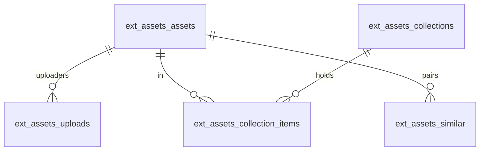

# Asset library 数据表

表归属：`assets`；定义在 `api/schema.ts`，访问经插件 services bag（`api/store.ts`）。迁移 `migrations/0001_assets.sql` 在插件启用时建表。停用不删表；`cli plugins drop assets --yes` 才移除（对象存储里的文件不随之删除）。

| 对象 | 键或目标 | 用途 / 规则 |
|---|---|---|
| `ext_assets_assets` | PK `id`（`ast_`）；UK `sha256` | 一份内容一行。状态 uploading / active / invalid / deleted；成员字段（title、description、tags、facets、source）与 `ai_*` 字段分开；`display_title` 与 `search_a/b/c`、生成列 `search_tsv` 随写入重算；`upload_generation` 是当前上传尝试（浏览器只写 `staging/<id>/<generation>/`，完成时由服务端复制到内容寻址键）；`verified_at` 是服务端复核哈希的时间；`purging` 表示正在删对象，期间不能完成、恢复、合并或重传 |
| `ext_assets_uploads` | PK `(asset_id, user_id)` → assets（cascade） | 谁上传过这份内容、用的文件名 |
| `ext_assets_collections` | PK `id`（`acl_`） | 合集；`created_by` 可改名、删除 |
| `ext_assets_collection_items` | PK `(collection_id, asset_id)`，两端 cascade | 合集成员 |
| `ext_assets_facets` | PK `key` | 管理员配置的分类与取值（`values` = `{value, zh?}[]`），`multiple` 单选 / 多选 |
| `ext_assets_similar` | PK `(asset_id, other_id)`，`asset_id < other_id`，两端 cascade | 感知哈希距离 ≤ 6 的疑似重复对；open / dismissed / merged |
| `*.uploaded_by` / `user_id` / `created_by` | `users.id`（逻辑引用） | 成员 id |

