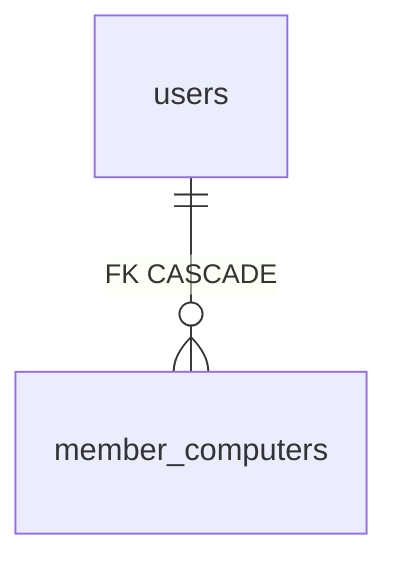

# Computer 数据表

表归属：`member_computers`；定义在 `api/schema.ts`，访问经插件自身的 services bag。迁移 `migrations/0001_adopt.sql` 保留全部 3.0 列、约束和索引，只认领，不搬数据。停用不删表；显式 `cli plugins drop computer --yes` 才移除。

| 对象 | 键或目标 | 用途 / 规则 |
|---|---|---|
| `member_computers` | PK `id`；部分 UK `user_id`（starting / running / stopping） | 成员云电脑；状态只经 service 的 CAS 改；`sandbox_id`、`minutes_billed`、`budget_key` |
| `member_computers.user_id` | `users.id` | CASCADE |
| `member_computers.oauth_client_id` / `budget_key` | `oauth_clients.id` / 预留键 | 开机来源与计费 |

