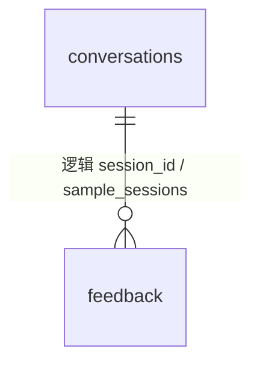

# Feedback 数据表

表归属：`feedback`；定义在 `api/schema.ts`，访问经插件自身的 services bag。迁移 `migrations/0001_adopt.sql` 是本插件基线：新装在插件启用时建表；从 3.x 升级的库原地认领已有表（列、约束、索引与 3.x 一致），不搬数据。停用不删表；显式 `cli plugins drop feedback --yes` 才移除。

| 对象 | 键或目标 | 用途 / 规则 |
|---|---|---|
| `feedback` | PK `id`；部分 UK `fingerprint` | `kind=request`：成员提的需求（pending / accepted / rejected / done、`priority`、`submitted_by`）；`kind=friction`：Agent 踩坑信号（new / acknowledged / resolved / archived、`fingerprint`、`tool_id`、`friction_kind`、`occurrence_count`、`sample_sessions` 最近 5 个会话 id），永不进 prompt。CHECK `chk_feedback_shape` |
| `feedback` | `kind` | request / friction |
| `feedback.submitted_by` / `session_id` / `sample_sessions[]` | `users.id` / `conversations.id` | 遥测比会话长寿 |

