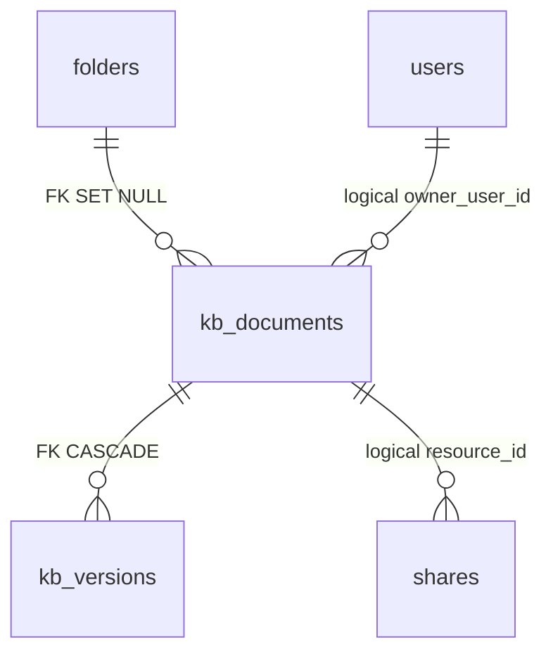

# Knowledge 数据库归属

事实源为 `api/schema.ts` 与 `migrations/0001_adopt.sql`。认领既有表，不复制记录；关闭插件保留表、版本和分享。

### 知识库（knowledge.ts）

| 表 | 主键 / 唯一 | 用途与关键列 |
|---|---|---|
| `kb_documents` | PK `id`；UK `(doc_id, scope)` | 文档；`content`（Markdown 为准）+ `content_json`（Tiptap）、`visibility` team / private + `owner_user_id`、`status`、`is_template`、`tags`、`meta`、`folder_id`（FK SET NULL，`folders.scope='kb'`）、`sort_order`；`_summary` / `_questions` / `_topics` 富化；检索列 `search_a/b/c` + 生成列 `search_tsv`（GIN） |
| `kb_versions` | PK `id`；UK `(doc_id, version)` | 不可变版本历史；FK `doc_id` CASCADE |

文档的单人分享在 `shares`（`resource_type='kb_document'`）。

## 关系与检索

- `kb_documents.folder_id → folders.id`：FK SET NULL。核心目录删除前调用 scope 的占用检查；非归档文档仍在时拒绝删除。
- `kb_versions.doc_id → kb_documents.id`：FK CASCADE。
- `owner_user_id` / `created_by` / `updated_by` / `changed_by`：逻辑关联 `users.id`。
- 单人分享复用核心 `shares`，`resource_type='kb_document'`；附件关联复用 `file_links`，`target_type='kb_document'`。
- 应用层共用 jieba `segmentForFts` 生成 `search_a/b/c`；`simple` 生成列 `search_tsv` 配合 GIN 索引。查询依次 AND、OR 补位、ILIKE；CJK snippet 从原文截取。
- `content` 是规范 Markdown；`content_json={}` 合法，版本不可变。种子保留 Markdown，不强制补编辑器状态。
- `0009_knowledge_plugin_ownership` 只推进 core snapshot，删除 schema 所有权，不删除表。

