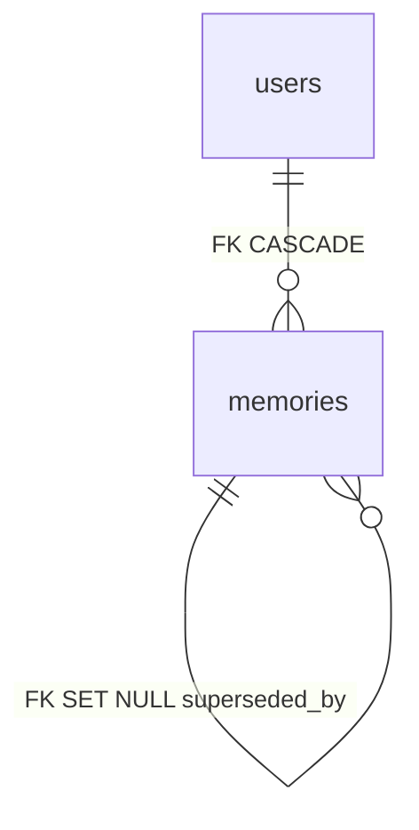

# Memory 数据表

表归属：`memories`；定义在 `api/schema.ts`，访问经插件自身的 services bag。迁移 `migrations/0001_adopt.sql` 保留全部 3.0 列、约束和索引，只认领，不搬数据。停用不删表；显式 `cli plugins drop memory --yes` 才移除。

| 对象 | 键或目标 | 用途 / 规则 |
|---|---|---|
| `memories` | PK `id` | 成员的 Agent 记忆；`status` active / dormant / archived / superseded 是真相，`superseded_by` 自引用 SET NULL，`title` 是唯一进 prompt 的部分 |
| `memories.user_id` | `users.id` | CASCADE |
| `memories.superseded_by` | `memories.id` | SET NULL |
| `memories.source_session_id` | `conversations.id` | 记忆来源 |

